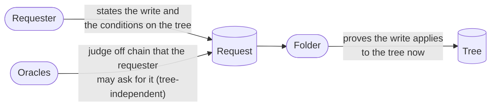

# Decisions

**As a reviewer of this design, I want every choice next to the alternatives
it rejected, so that I can judge the reasoning and not only the result.**

The decisions were taken in October 2026, starting from the Singular
investigation in which the request lifecycle belongs to the application
([lambdasistemi/singular#731](https://github.com/lambdasistemi/singular/issues/731),
[#741](https://github.com/lambdasistemi/singular/issues/741)). The design went
through a single-oracle version, a multi-oracle version, two independent
audits and one repair; the tables below record what each step taught. The
authoritative record is
[`specs/request-approval-fold/decisions.md`](https://github.com/cardano-foundation/cardano-mpfs-onchain/blob/main/specs/request-approval-fold/decisions.md).

## Who checks what

| Decision | Chosen | Rejected | Why |
|---|---|---|---|
| What an oracle judges | Authorization of the request, independent of the tree (for Moog: GitHub keys, repository roles, signatures) | Judging the change against the current root | Any fold changes the root while an oracle is deciding; a tree-bound approval would go stale before it could be used |
| Where tree validity is checked | At the fold, by conditions on any key, against the tree reached when the request is applied | Binding the request to the root it was created against | A request bound to one root dies at the next fold, so an oracle's work would be wasted whenever anyone else folds first |
| What a request may write | One `set key value` or `unset key`, plus conditions `key absent` or `key equals value` | Only the shipped compare-and-swap operations | Compare-and-swap is a write with a condition on its own key; conditions on other keys let applications state rules a generic registry cannot foresee |
| Who folds | Anyone | Only the oracle or owner | Folding needs no knowledge of the application, so it can be a generic service across every registry |
| Externalized per-key state, as in Singular | Out of scope; everything stays in the tree | Generalizing one design to cover both | Per-key tokens minted and burned at the fold are a different system; combining both would complicate each |

## Registries

| Decision | Chosen | Rejected | Why |
|---|---|---|---|
| Who may create a registry | Anyone, by minting a cage state that names its oracles and protocol | Creating a cage that applies a per-cage script | No script per registry means nothing to publish or audit per registry |
| How many oracles | A non-empty set, every one of which must approve | One oracle per registry | Different oracles check different things, so applications are composed from oracles, which may be shared between applications |
| Changing the oracle set | Never: the oracles and the protocol are the registry's identity | An owner who can change it; changes approved by the current oracles | Every entry means "judged by these oracles under this protocol"; changing them leaves part of the tree judged one way and part another, and no migration repairs that |
| Owner, end, transfer | None | An owner who can end or freeze the registry | The oracles are the only judges and they only judge requests; a central power above distributed judgment makes no sense. A registry whose oracles stop answering simply stops moving |
| Oracle consent to being listed | Not needed | Requiring oracles to sign the registry | Listing is an offer of business; an oracle that does not serve a registry never answers it |
| What the oracles understand | The registry names a protocol by hash: a CDDL document for keys, values and evidence | No declared protocol | An oracle cannot judge a request whose meaning it does not know; the protocol affects progress, never safety |

## Requests

| Decision | Chosen | Rejected | Why |
|---|---|---|---|
| Where requests live | One request script per release, serving every registry, as spending validator and minting policy | A request script applied per cage (shipped); requests held in the requester's own wallet | A per-cage script publishes one address per registry; a request in a wallet cannot be forced into the fold, which must spend it |
| Replay protection | A seed: an output reference spent by the creating transaction | Nothing beyond the request contents | Two identical requests would let one approval be reused for the other |
| Where the write lives | On chain in the request datum, paid by the requester | Off chain behind a hash | Readers rebuild the tree by replaying folds at no cost. A protocol may still store a hash as the value and leave its preimage to the key holder |
| Where the oracles' evidence lives | An opaque field; the protocol decides whether it holds the evidence or its hash | Forcing one or the other | On chain lets anyone audit the oracles' reasons; off chain is cheaper. Both have uses |
| Lifetime | A deadline and a window, chosen by the requester | Withdrawal at any time | Oracles that already judged would lose their fee to a requester who leaves; enough such requests starve the oracles |

## Judgments and discovery

| Decision | Chosen | Rejected | Why |
|---|---|---|---|
| How an oracle approves | Mints an approval token, with the request output as a reference input, into any output (typically its own wallet) | Minting into the request output, which spends it; one voucher output per oracle at the script | Spending the request makes several oracles race for one output; vouchers put several extra outputs per request at the script |
| What a judgment's name binds | The registry, the request with its seed, the oracle and the verdict | The registry and request only | Without oracle and verdict, approvals and refusals from different oracles would collide |
| Approval expiry | None: the request's deadline bounds every judgment | An expiry chosen by the oracle, with a minimum window protecting the requester | Once fees are paid only at the fold, a late or short-lived approval costs the requester nothing; an oracle that finds a deadline too far for its judgment simply does not answer |
| How oracles find work | A tag minted with the request, named after the registry; one asset query | Inspecting the address's staking part | The staking-part trick was declined as obscure; a token query is standard |
| How folders find work | Approval tokens | A separate index | The approvals already identify registry and request |
| An oracle answering both ways | Accepted, not prevented | A ballot per oracle minted with the request and burned at judgment, so each oracle can answer once | Under one exit per window, equivocation changes no payment and no outcome; the two verdicts stay on chain under the oracle's signature, so it is public and provable. Ballots would add one output per oracle to every request |

## Money and exits

| Decision | Chosen | Rejected | Why |
|---|---|---|---|
| What the requester pays for | Judgment, not outcome: approval and refusal pay the same fee | A fee only for approval; paid refusal as an opt-in | Equal fees make the oracle indifferent between verdicts, so it judges honestly; an oracle paid only to refuse could target a requester |
| When oracles are paid | From escrow in the request, at the fold or the settlement | At the first approval (spending the request); paid up front at creation | Paying at approval reintroduces contention; prepayment pays oracles that never answer |
| What happens to the remainder at a fold | It is the folder's bid | Refunded to the requester | No refund outputs per request, so folds batch more requests; the bid is what pays folders |
| Leaving a request that cannot fold | A complete account: a verdict from every oracle, every oracle paid, the rest to the owner | Consuming the request by proving one of its conditions false; letting one approving oracle close it; incremental claims by each oracle | A provable failure can be engineered by approving a conflicting request; one closing oracle can be bribed to omit the others; incremental claims make the oracles contend |
| When a settlement is allowed | Only from the deadline to the deadline plus the window | At any time; before the deadline with at least one refusal | Any overlap with the fold window creates a race between folder and owner; an early exit on one refusal lets the owner hide the other approvals, or pays oracles that never judged |
| A silent oracle | After the window the owner takes everything and may pay those who answered | Paying every oracle regardless | The chain cannot tell a silent oracle from an approval the owner chooses not to show; a silent oracle losing its fee is the incentive to answer |

## Not decided

These points are tracked in
[#116](https://github.com/cardano-foundation/cardano-mpfs-onchain/issues/116):

- one tag per request named after the registry, or one tag per oracle so that
  each oracle finds all its pending requests across every registry with one
  query;
- ordering as an auction: when approved requests conflict, the folder's order
  decides which wins, and bids can buy that order;
- hold-up by complementary oracles: each oracle can block a request, so the
  total price of judgment tends to exceed that of one integrated oracle;
- the encodings of names and datums, CBOR specified in CDDL as in Singular;
- the migration or coexistence of existing cages
  ([#117](https://github.com/cardano-foundation/cardano-mpfs-onchain/issues/117));
- the fold cost per condition proof and per judgment reference, to be measured
  on a devnet ([#115](https://github.com/cardano-foundation/cardano-mpfs-onchain/issues/115)).
