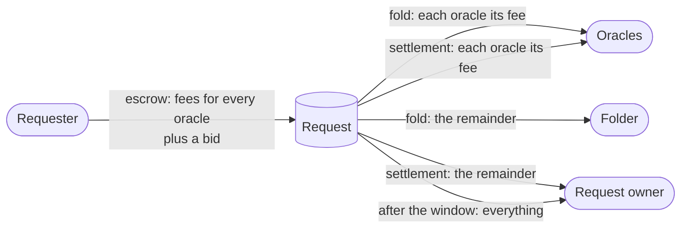

# Economics

**As someone deciding whether to run an oracle, fold requests or build an
application on a registry, I want to know who pays whom and what each role
earns, so that I can tell whether the role is worth taking.**

## Money flows

| Exit | Oracles | Folder | Request owner |
|---|---|---|---|
| Fold, before the deadline | Each its declared fee | Everything else | Nothing back; the write is applied |
| Complete account, in the window | Each its declared fee, whatever its verdict | Nothing | Everything else |
| Withdrawal, after the window | Whatever the owner chooses to pay | Nothing | Everything |

## Three markets instead of one

The shipped cage has one business: the owner, which is both the only oracle
and the only folder, takes a fixed tip per request. It is a monopoly on its
cage, and requests can only leave through it or after a retract window. This
design splits that into separate markets:

- **Judgment.** Oracles sell verdicts at a price the requester posts, one fee
  per oracle. An oracle takes the request or ignores it. Because approval and
  refusal pay the same, an oracle earns by judging, never by choosing a
  verdict.
- **Folding.** Folding needs no knowledge of the application, and one request
  address per release serves every registry, so a single folder can serve all
  of them. Competition among folders pushes the bid towards the real cost of a
  fold: the transaction fee, the proofs and the latency.
- **Ordering.** The folder chooses the order of a fold. When two approved
  requests conflict, for example both setting a key under the condition that
  it is absent, the order decides which one wins, and bids can buy that order.
  In the shipped cage this power belonged to the owner. This is accepted: the
  losing request costs only its fees, and an application that wants fair
  ordering gets it from its oracles, which can approve only one of
  conflicting requests.

## Risks each role carries

| Role | Carries | Bounded by |
|---|---|---|
| Requester | Fees paid even when refused; the wait until the deadline if refused or unfoldable | Its own choice of fees, deadline and window |
| Oracle | Judging work on a request that never folds | Payment at settlement for every verdict; silence is the only unpaid case, and it is the oracle's own |
| Good oracle in a registry with a silent oracle | Requests that cannot fold, settled only if the owner pays after the window | Its decision to stop serving that registry |
| Folder | Losing a race for the cage state to another folder | A transaction whose inputs were already spent is rejected before any script runs, and costs nothing |
| Registry creator | Choosing oracles that later go silent | Nothing: trust is placed in the oracles when they are named; a dead registry is replaced by a new one |

## Several oracles holding up a request

When every oracle must approve, each can block a request, and fees are fixed
in the request: an oracle cannot raise its price on chain, but it can decline
until the requester re-creates the request with a higher fee. Complementary
monopolies tend to price the whole above what one integrated oracle would.
This is accepted: since silence earns nothing and a refusal pays the same as
an approval, holding out is only pricing. To make prices discoverable, each
oracle keeps an on-chain price notice: a token named after it whose datum
carries its current fee, so a wallet adds up a registry's price with one query
per oracle before creating a request. The notice is not binding, but an oracle
ignoring requests that pay its posted price contradicts its own signed notice
in public.

## The shipped cage as a special case

| Shipped cage | In this design |
|---|---|
| The owner is the only oracle and the only folder | A registry with one oracle that signs its own folds |
| `Insert value` | `set key value` with the condition `key absent` |
| `Delete value` | `unset key` with the condition `key equals value` |
| `Update old new` | `set key new` with the condition `key equals old` |
| The tip per request | The oracle's fee |
| The processing window, then the retract window | The deadline, then the settlement window, then the owner's withdrawal |
| Owner can transfer or end the cage | No counterpart |

Simulating the shipped cage costs a tag minted and burned per request (one
oracle, one tag), one
more script run per fold transaction, and a larger datum. It costs no extra
proof: a condition and a write on the same key share one Merkle Patricia
Forestry proof. Conditions on other keys are new, and paid for only when used.
Because the remainder of a request goes to the folder, a fold writes no refund
output per request, so batches can be larger than today.

## For applications

- **Composition.** An application is a registry plus a set of oracles, and it
  can reuse third-party oracles, such as one identity oracle shared by many
  registries.
- **No folding infrastructure.** An application's requests keep moving while
  its own machines are down; only judgment depends on it.
- **Censorship.** Oracles can still refuse to answer, but no folder can
  censor an approved request: anyone can fold it.
- **Rules on other keys.** Conditions let an application express invariants
  across the tree, which the fold enforces.
- **Limits.** No first-come-first-served order can be imposed on folders,
  only conditions; and a request still carries one write.
