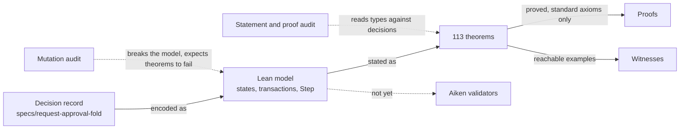
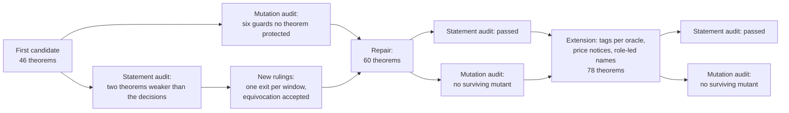
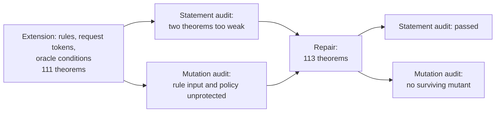

# Formal model and audits

**As someone who will implement or rely on this design, I want to know
exactly which guarantees are proved, how the proofs were checked, and what is
not covered, so that I do not mistake a modelled property for an implemented
one.**

The design is modelled in Lean 4 under
[`lean/MpfsCage/RequestApprovalFold/`](https://github.com/cardano-foundation/cardano-mpfs-onchain/tree/main/lean/MpfsCage/RequestApprovalFold).
The proofs establish properties **of the model**. They do not establish that
the validators implement it: no validator implements it yet, and conformance
is a separate milestone ticket
([#114](https://github.com/cardano-foundation/cardano-mpfs-onchain/issues/114)).

## From decision to evidence

## The model

| Part | What it captures |
|---|---|
| Trie, writes, conditions | The tree as a map from keys to values; `set` and `unset`; `absent`, `present` and `equals`; ordered application within a fold |
| Registry state | Registry identity, oracle set, protocol hash, optional rule and tree |
| Request output | Registry, owner, seed, a fresh output reference, one write, conditions, a fee per oracle, deadline, window, evidence, escrow, its request token and one tag per oracle |
| Judgment | Registry, request, oracle, verdict and, for an approval, the oracle's own conditions, all bound in its name |
| Price notice | An oracle's price token and its current fee, optionally per protocol |
| Transactions | Creation, judgment, fold, complete account, owner withdrawal, judgment burn, and price notice minting and update, each with its guard |
| Step | The authoritative transition relation over a global state, labelled by the exact transaction performed |

Modelling choices the decisions left open, ruled before the model was
written: a registry has at least one oracle or a rule, and no repeated oracle;
the rule is an abstract predicate over one request and the creating
transaction's signatures; each oracle
has its own non-negative fee; creation requires escrow covering the sum of the
fees; time is a single observed value whose soundness against transaction
validity intervals is assumed; names are collision-free structured values,
standing for the hashes the implementation will use.

!!! note "Decisions not yet in the model"
    Oracle identities (keys and groups with shares), fees accumulated per key
    in the registry state, and complete accounts and claims as items of the fold were
    decided after this model was audited. The model still names oracles as
    single keys and pays each oracle's fee in its own output.

## What is proved

All 113 theorems are proved; `#print axioms` lists only `propext`,
`Classical.choice` and `Quot.sound` for each.

| Guarantee | Proved by |
|---|---|
| A registry's oracles and protocol never change, and only a fold changes its tree | `registry_creation`, `fold_preserves_registry`, `step_preserves_registry`, `history_preserves_registry`, `only_fold_changes_tree` |
| A request is created only for a registry present in the state, with its seed spent, one tag per oracle and enough escrow; no request ever recurs | `create_tags_existing_cage`, `creation_references_source`, `creation_funds_declared_fees`, `requests_unique_in_history`, `used_seeds_monotone`, `reachable_requests_have_spent_seeds`, `spent_seed_cannot_create_again`, `request_never_reappears` |
| Only an oracle of the registry can judge, before the deadline, and a judgment binds registry, request, oracle and verdict and cannot be replayed | `judgment_authorized_and_bound`, `judgment_not_replayable`, `token_roles_separated`, `new_judgment_is_authorized`, `judgments_do_not_consume` |
| A fold applies only fully approved requests, before the deadline, each at most once, with its conditions true against the tree at its turn, and the new root is exactly the writes applied in order | `fold_only_approved_before_deadline`, `fold_references_authentic`, `fold_requests_unique`, `fold_conditions_hold_when_applied`, `fold_root_is_folded_writes`, `foldRun_step_valid`, `foldRun_result`, `foldRun_conditions`, `applyAll_append`, `applyAll_keeps_present`, `absent_inserts_exclusive`, `blind_write_folds_on_any_tree` |
| Anyone may fold, and one oracle signature on the fold stands for that oracle's approval | `fold_permissionless`, `one_oracle_signature_suffices` |
| Exact payments: every oracle its own fee, the remainder to the folder or the owner, nothing created or lost | `fold_payments_concrete`, `account_payments_concrete`, `fold_pays_and_keeps_rest`, `allocation_conserves_value` |
| A settlement needs a verdict from every oracle, is open to anyone inside its window, accepts any mix of verdicts, and pays the same whichever verdicts are shown | `account_complete_and_pays`, `account_anyone_in_window`, `account_accepts_any_verdicts`, `account_references_authentic`, `account_fee_neutral` |
| Only the owner withdraws, only after the window, and takes everything | `withdraw_only_owner_after_window`, `owner_can_withdraw_everything` |
| Exactly one exit per moment: each exit lies in its window, the windows cover all time, and two allowed spends at the same time are the same exit | `exit_time_window`, `exit_windows_cover`, `exit_kind_unique` |
| A request leaves only through a legal exit bound to the transaction that removed it, every exit burns its tag, and before the window ends every oracle has judged and is paid | `live_removal_is_legal_exit`, `request_spent_only_by_lifecycle`, `every_exit_burns_tag`, `exits_remove_consumed`, `fold_removes_consumed`, `early_exit_requires_all_judgments`, `early_exit_pays_every_oracle`, `before_deadline_only_approvals` |
| An oracle answering both ways is reachable and changes no payment; dead judgments can always be burned, and a burn removes exactly the token burned | `equivocation_reachable`, `dead_judgment_can_burn`, `burn_removes_one`, `burn_keeps_history` |
| The shipped `Insert`, `Delete` and `Update` are writes with a condition on their own key, with the same effect on the tree | `old_operations_correspond` |
| An oracle's tag is in a live request exactly when that oracle judges the request's registry, across all registries; each live request holds one tag per oracle, none repeated, and every removal burns them | `discovery_iff`, `discovery_across_registries`, `reachable_live_tags`, `reachable_tags_unique`, `reachable_registry_valid`, `live_removal_burns_oracle_tags` |
| Only an oracle can mint or update its price notice; notices change no registry, request, judgment or payment, and bind nothing | `price_mint_inversion`, `price_update_inversion`, `price_mint_available`, `price_update_available`, `reachable_notice_names`, `notice_change_authorized`, `price_notice_noninterference`, `notices_do_not_bind_protocol` |
| Every hashed name is led by its role; names are injective and names of different roles never coincide | `tag_name_injective`, `price_name_injective`, `different_roles_never_coincide`, `names_have_leading_roles`, `request_name_injective` |
| A registry's rule is fixed at creation and judges exactly the request created and the creating transaction's signatures; it is never consulted again, so every exit and every judgment burn works whatever the rule says | `creation_rule_and_token`, `creation_rule_input_binding`, `step_rule_immutable`, `history_rule_immutable`, `reachable_rule_admitted`, `fold_rule_predicate_independent`, `every_rule_allows_burn` |
| Each live request holds its registry's request token, minted by the rule's policy when the registry has a rule and by the release policy otherwise; the fold needs it and every exit burns it | `creation_request_policy`, `reachable_request_tokens`, `fold_requires_request_token`, `every_exit_burns_request_token`, `live_removal_burns_request_token` |
| The request token of a registry is held exactly by its live requests, across all registries; output references are fresh and never repeat | `request_token_discovery`, `request_token_discovery_across_registries`, `output_refs_monotone`, `reachable_output_refs`, `reachable_output_refs_unique` |
| A registry needs at least one oracle or a rule; with no oracles it needs no seed, no approvals to fold and no verdicts to settle | `unguarded_registry_impossible`, `zero_oracle_needs_rule`, `zero_oracle_evidence_empty`, `zero_oracle_creation_without_seed`, `zero_oracle_fold_without_approvals`, `zero_oracle_account_without_verdicts` |
| A fold applies a request only if its own conditions and every approving oracle's conditions hold on the tree at its turn; an approval cannot be shown with other conditions, and one whose conditions no longer hold cannot be used | `present_condition_semantics`, `foldRun_oracle_conditions`, `fold_all_conditions_hold`, `approval_conditions_cannot_change`, `stale_approval_unusable`, `fold_evidence_binds_conditions` |
| A folder that lists a registry's live requests and the authentic judgment outputs finds exactly the foldable requests | `expected_approval_lookup`, `folder_discovery_exact`, `folder_discovery_executable` |
| An empty fold is allowed and earns nothing | `empty_fold_allowed`, `empty_fold_earns_nothing` |

## How it was checked

Two independent audits ran on the first candidate, and fresh ones on the
repair. Each auditor worked on a frozen copy with a sealed list of inputs and
never contacted the author.

| Audit | First candidate | Repaired candidate |
|---|---|---|
| Statements and proofs: does each theorem say what the decisions promise, is it reachable, is it proved? | Two failures: the legal-exit theorem did not bind the exit to the actual removal, and the approval-disclosure theorem relied on an assumption no decision granted | Passed on every row except the independent blind reading of the statements, which was not commissioned |
| Mutations: does breaking the model make a theorem fail? | Six model changes passed every theorem: forged judgment references at the fold and at settlement, a request for a foreign registry, a diverted remainder, swapped fees, a burn that kept the token, a duplicate request in a fold | 98 single-edit mutants; none passes the full build; 59 of 60 theorems are each killed by a relevant mutant |

The extension for tags per oracle, price notices and role-led names was audited the same way: the statement and proof audit passed every row except the uncommissioned blind reading, and the mutation audit ran 100 single-edit mutants, none of which passes the full build; 75 of 78 theorems are each killed by a relevant mutant.

The extension for registry rules, request tokens, registries without oracles,
the `present` condition and oracle conditions needed one repair. The statement
audit found the dead-judgment burn theorem limited to approvals without
conditions, and the rule-burn theorem true by definition. The mutation audit
found that a rule fed a different request or different signatures, or a
request token minted by the release policy despite a rule, broke no theorem.
The repair restated the first two theorems over the actual transitions and
added theorems binding the rule to the created request and the creating
signatures, and the request token to the rule's policy. On the repair, the
statement and proof audit passed every row except the uncommissioned blind
reading, and the mutation audit ran 145 single-edit mutants, none of which
passes the full build; 105 of 113 theorems are each killed by a relevant
mutant.

What the mutation audit could not count as killed, none of it a defect:

- the theorem that the windows cover all time is arithmetic over time alone,
  so no change to the model can falsify it; the timing of each exit is
  protected separately;
- a mutant that forbids an oracle from answering both ways does falsify the
  equivocation theorem, as a separate proof shows, but the build fails first
  in the examples, so the strict rule of the audit leaves it uncounted.
- the theorems that tags are unique per request and that discovery works
  across registries are each guarded by an earlier theorem that the
  relevant mutant breaks first (registry validity, and discovery itself), so
  the fault is caught but not credited to them;
- in the same way, discovery of requests across registries, the burn of the
  request token on every removal, the need for a rule in a registry without
  oracles, and the uselessness of a stale approval are each guarded by an
  earlier theorem (request-token discovery, the burn of tags on every exit,
  the impossibility of a registry with neither oracles nor rule, and the fold
  proving every condition) that the relevant mutant breaks first.

## What is not covered

| Not covered | Where it is tracked |
|---|---|
| One request script per release, serving every registry in both roles: the model has no notion of a script or a release | Recorded as a model omission; implemented by [#110](https://github.com/cardano-foundation/cardano-mpfs-onchain/issues/110) |
| The ledger queries folders run: the model proves that a folder finds exactly the foldable requests from a registry's live requests and the authentic judgment outputs, but the queries that produce them are outside it | Implemented by [#113](https://github.com/cardano-foundation/cardano-mpfs-onchain/issues/113) |
| An executable model, codecs and a replay corpus for conformance testing | [#109](https://github.com/cardano-foundation/cardano-mpfs-onchain/issues/109) |
| Conformance of the Aiken validators with the model | [#114](https://github.com/cardano-foundation/cardano-mpfs-onchain/issues/114) |
| Concrete encodings and hashes of names and datums | [#116](https://github.com/cardano-foundation/cardano-mpfs-onchain/issues/116) |
| Costs and transaction limits | [#115](https://github.com/cardano-foundation/cardano-mpfs-onchain/issues/115) |
