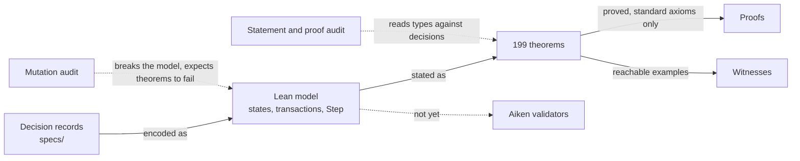
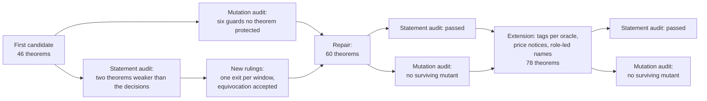
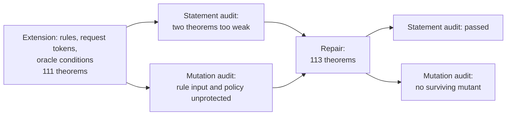
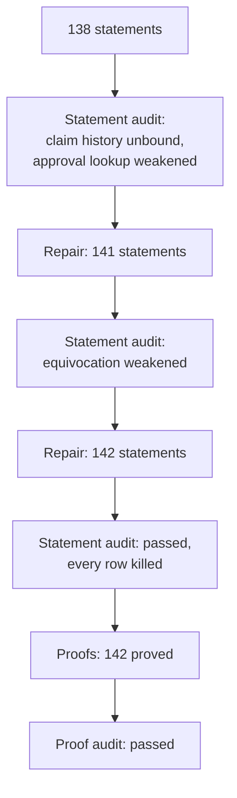
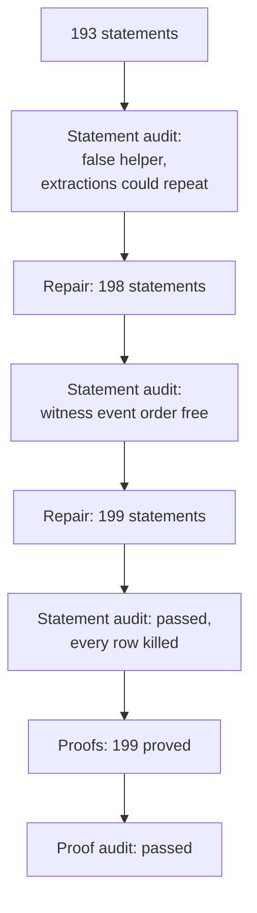
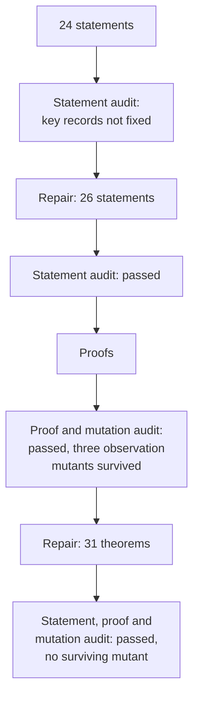

# Formal model and audits

**As someone who will implement or rely on this design, I want to know
exactly which guarantees are proved, how the proofs were checked, and what is
not covered, so that I do not mistake a modelled property for an implemented
one.**

The design is modelled in Lean 4 under
[`lean/MpfsCage/RequestApprovalFold/`](https://github.com/cardano-foundation/cardano-mpfs-onchain/tree/main/lean/MpfsCage/RequestApprovalFold).
The proofs establish properties **of the model**. They do not establish that
the validators implement it: no validator implements it yet, and conformance
is a separate milestone ticket
([#114](https://github.com/cardano-foundation/cardano-mpfs-onchain/issues/114)).

## From decision to evidence

## The model

| Part | What it captures |
|---|---|
| Trie, writes, conditions | The tree as a map from keys to entries; `set` and `unset`; `absent`, `present` and `equals`, read on the logical tree, the tree with every witness removed; ordered application within a fold |
| Durable witness | A witnessed entry holding the attested value or absence, the deposit and the refund address, with one witness token in its own output at the registry state's address, bound to the request that issued it |
| Registry state | Registry identity, oracle identities, protocol hash, optional rule, tree, one fee balance per key, and a value equal to the sum of the balances |
| Request output | Registry, owner, seed, a fresh output reference, one write, conditions, a fee per oracle, deadline, window, evidence, escrow, its request token and one tag per oracle |
| Judgment | Registry, request, oracle identity, verdict, the record of the members that signed and, for an approval, the oracle's own conditions, all bound in its name |
| Claim | A claim token named after the registry, the claiming key, the destination address and datum of the payout, a deadline and a tip |
| Price notice | An oracle identity's price token and its current fee, optionally per protocol |
| Extraction | A request that names a key and the value or absence it wants witnessed, with its deposit, refund address, remainder, deadline and window, and no oracle fees |
| Transactions | Creation, judgment, fold, owner withdrawal, claim creation, claim withdrawal, extraction creation, extraction withdrawal, judgment burn, and price notice minting and update, each with its guard |
| Fold items | A write request, a complete account, a claim, an extraction and the complete account of an extraction, each applied to the state the previous item left, under one validity interval that fits every item |
| Step | The authoritative transition relation over a global state, labelled by the exact transaction performed |

Modelling choices the decisions left open, ruled before the model was
written: a registry has at least one oracle or a rule, and no repeated oracle;
the rule is an abstract predicate over one request and the creating
transaction's signatures; each oracle
has its own non-negative fee; creation requires escrow covering the sum of the
fees plus the ledger minimum, a fixed positive parameter of the registry; time is a single observed value whose soundness against transaction
validity intervals is assumed; names are collision-free structured values,
standing for the hashes the implementation will use.

Readings of the money decisions, ruled before the fee balances were stated:

- conservation counts the registry's value on both sides: its value before,
  plus the request escrows and claim escrows, equals its value after, plus the
  request remainders, claim payouts and claim tips; the registry's permanent
  minimum reserve is outside this account;
- a claim output holds its tip, which goes to the folder when the claim is
  folded and back to the claiming key on withdrawal; a claim folds strictly
  before its deadline and is withdrawn from its deadline on, so there is no gap;
- a complete account pays the same total per oracle, and the same remainder to
  the owner, whichever verdicts are shown; when a group judged more than once
  with different signers, the folder's choice of judgment decides which of
  its keys are credited.

Readings of the durable witness decisions, ruled before the witnesses were
stated:

- a witness carries a declared deposit of at least the ledger minimum, which
  funds its output and is refunded exactly;
- an extraction is an ordinary request: it pays the folder its remainder and
  covers the ledger minimum at creation, declares no oracle fees, passes no
  rule, and keeps the three windows of every request; a request that never
  mints its witness returns the deposit to its owner;
- a witness is burned only by a fold item that changes its key's value, and
  then its deposit goes to its refund address; a write of the value already
  held keeps it, and a witnessing `set` of the value already witnessed is not
  folded;
- the issuer has no exit: no signature, deadline or withdrawal releases a
  live witness or its deposit;
- items are applied in order, so a fold that changes a key and changes it
  back burns the witness at the first change; a witness minted and burned
  inside one fold nets out on the transaction, and its issuer is still
  refunded;
- a witness of presence is a witness of an exact value read as presence: an
  extraction names the value it wants witnessed, and any value change burns
  it.

!!! note "Decisions not yet in the registry model"
    Slots
    ([#129](https://github.com/cardano-foundation/cardano-mpfs-onchain/issues/129))
    were drafted after this model was audited.

## What is proved

All 199 theorems are proved; `#print axioms` lists only `propext`,
`Classical.choice` and `Quot.sound` for each.

| Guarantee | Proved by |
|---|---|
| A registry's oracles and protocol never change, and only a fold changes its registry state: its tree or its balances | `registry_creation`, `fold_preserves_registry`, `step_preserves_registry`, `history_preserves_registry`, `only_fold_changes_tree`, `only_fold_changes_registry`, `request_withdrawal_preserves_registry` |
| A request is created only for a registry present in the state, with its seed spent, one tag per oracle and enough escrow; no request ever recurs | `create_tags_existing_cage`, `creation_references_source`, `creation_funds_declared_fees`, `requests_unique_in_history`, `used_seeds_monotone`, `reachable_requests_have_spent_seeds`, `spent_seed_cannot_create_again`, `request_never_reappears` |
| Only an oracle of the registry can judge, before the deadline, with the authorization of its identity, and a judgment binds registry, request, oracle, verdict and the members that signed, and cannot be replayed | `judgment_authorized_and_bound`, `judgment_not_replayable`, `judgment_record_cannot_change`, `token_roles_separated`, `new_judgment_is_authorized`, `judgments_do_not_consume` |
| A fold applies only fully approved requests, before the deadline, each at most once, with its conditions true against the tree at its turn, and the new root is exactly the writes applied in order | `fold_only_approved_before_deadline`, `fold_references_authentic`, `fold_requests_unique`, `fold_conditions_hold_when_applied`, `fold_root_is_folded_writes`, `foldRun_step_valid`, `foldRun_result`, `foldRun_conditions`, `applyAll_append`, `applyAll_keeps_present`, `absent_inserts_exclusive`, `blind_write_folds_on_any_tree` |
| Anyone may fold, and one oracle signature on the fold stands for that oracle's approval | `fold_permissionless`, `one_oracle_signature_suffices` |
| Exact payments: every oracle's fee credited to the balances of its keys, the remainder to the folder or the owner, and the fold's outputs exactly those payments | `fold_payments_concrete`, `account_payments_concrete`, `fold_pays_and_keeps_rest`, `allocation_conserves_value`, `fold_payments_exact` |
| Nothing is created or lost: the registry's value always equals the sum of its balances, and across a fold the value in equals the value out, per request and per balance | `reachable_balances_backed`, `fold_value_conservation`, `fold_request_conservation`, `fold_balance_conservation` |
| A group oracle's fee reaches only the members recorded in the judgment shown, split by their shares, in each item and across a whole fold | `group_credits_only_recorded_signers`, `group_credits_exact_split`, `fold_group_credits_only_recorded_signers` |
| A claim exists only if its key signed it, on the state's own history; at its turn it pays the key's whole balance to exactly the destination and datum fixed at creation, resets the balance and burns its token; a balance below the ledger minimum waits | `reachable_claim_authorization`, `trace_reachability`, `claim_creation_inversion`, `claim_item_inversion`, `claim_turn_balance`, `claim_payout_fixed`, `claim_payout_in_actual_outputs`, `claim_consumed_and_burned`, `claim_below_minimum_refused` |
| A claim folds before its deadline and is withdrawn by its key from the deadline on, with every moment in exactly one of the two; folders find a registry's claims by its claim token | `claim_windows_cover`, `claim_windows_disjoint`, `claim_withdrawal_inversion`, `claim_withdrawal_available`, `claim_discovery_exact` |
| A fold's validity interval fits every item in it, and every transition has an exact inversion | `fold_interval_fits_every_item`, `step_inversion`, `foldRun_inversion` |
| A settlement needs a verdict from every oracle, is open to anyone inside its window, accepts any mix of verdicts, and pays the same whichever verdicts are shown | `account_complete_and_pays`, `account_anyone_in_window`, `account_accepts_any_verdicts`, `account_references_authentic`, `account_fee_neutral` |
| Only the owner withdraws, only after the window, and takes everything | `withdraw_only_owner_after_window`, `owner_can_withdraw_everything` |
| Exactly one exit per moment: each exit lies in its window, the windows cover all time and never overlap, and two allowed spends at the same time are the same exit | `exit_time_window`, `exit_windows_cover`, `exit_windows_disjoint`, `exit_kind_unique` |
| A request leaves only through a legal exit bound to the transaction that removed it, every exit burns its tag, and before the window ends every oracle has judged and is paid | `live_removal_is_legal_exit`, `request_spent_only_by_lifecycle`, `every_exit_burns_tag`, `exits_remove_consumed`, `fold_removes_consumed`, `early_exit_requires_all_judgments`, `early_exit_pays_every_oracle`, `before_deadline_only_approvals` |
| An oracle answering both ways on a live request is reachable and changes no payment; dead judgments can always be burned, and a burn removes exactly the token burned | `equivocation_reachable`, `dead_judgment_can_burn`, `burn_removes_one`, `burn_keeps_history` |
| The shipped `Insert`, `Delete` and `Update` are writes with a condition on their own key, with the same effect on the tree | `old_operations_correspond` |
| An oracle's tag is in a live request exactly when that oracle judges the request's registry, across all registries; each live request holds one tag per oracle, none repeated, and every removal burns them | `discovery_iff`, `discovery_across_registries`, `reachable_live_tags`, `reachable_tags_unique`, `reachable_registry_valid`, `live_removal_burns_oracle_tags` |
| Only an oracle identity's authorization can mint or update its price notice; notices change no registry, request, judgment or payment, and bind nothing | `price_mint_inversion`, `price_update_inversion`, `price_mint_available`, `price_update_available`, `reachable_notice_names`, `notice_change_authorized`, `price_notice_noninterference`, `notices_do_not_bind_protocol` |
| Every hashed name is led by its role; names are injective and names of different roles never coincide | `tag_name_injective`, `price_name_injective`, `different_roles_never_coincide`, `names_have_leading_roles`, `request_name_injective` |
| A registry's rule is fixed at creation and judges exactly the request created and the creating transaction's signatures; it is never consulted again, so every exit and every judgment burn works whatever the rule says | `creation_rule_and_token`, `creation_rule_input_binding`, `step_rule_immutable`, `history_rule_immutable`, `reachable_rule_admitted`, `fold_rule_predicate_independent`, `every_rule_allows_burn` |
| Each live request holds its registry's request token, minted by the rule's policy when the registry has a rule and by the release policy otherwise; the fold needs it and every exit burns it | `creation_request_policy`, `reachable_request_tokens`, `fold_requires_request_token`, `every_exit_burns_request_token`, `live_removal_burns_request_token` |
| The request token of a registry is held exactly by its live requests, across all registries; output references are fresh and never repeat | `request_token_discovery`, `request_token_discovery_across_registries`, `output_refs_monotone`, `reachable_output_refs`, `reachable_output_refs_unique` |
| A registry needs at least one oracle or a rule; with no oracles it needs no seed, no approvals to fold and no verdicts to settle | `unguarded_registry_impossible`, `zero_oracle_needs_rule`, `zero_oracle_evidence_empty`, `zero_oracle_creation_without_seed`, `zero_oracle_fold_without_approvals`, `zero_oracle_account_without_verdicts` |
| A fold applies a request only if its own conditions and every approving oracle's conditions hold on the tree at its turn; an approval cannot be shown with other conditions, and one whose conditions no longer hold cannot be used | `present_condition_semantics`, `foldRun_oracle_conditions`, `fold_all_conditions_hold`, `approval_conditions_cannot_change`, `stale_approval_unusable`, `fold_evidence_binds_conditions` |
| A folder that lists a registry's live requests and the authentic judgment outputs finds exactly the foldable requests | `expected_approval_lookup`, `folder_discovery_exact`, `folder_discovery_executable` |
| An empty fold is allowed and earns nothing | `empty_fold_allowed`, `empty_fold_earns_nothing` |
| Witnesses are invisible to meaning: conditions, the root and every earlier theorem read the logical tree, the tree with every witness removed | `logical_tree_stripped`, `conditions_read_logical` |
| In every reachable state the live witness tokens match the witnessed entries one to one, fact, deposit and refund address included; each live witness's fact holds; a key has at most one witness | `reachable_witness_bijection`, `live_witness_fact`, `live_witness_presence`, `live_witness_absence`, `one_live_witness_per_key`, `witness_reference_sound`, `witness_origin_on_trace`, `witness_token_issuance_bound` |
| A witness is burned exactly by a fold item that changes its key's value; a write of the value already held, writes to other keys and every other transaction leave it, its token, its output and its deposit untouched | `item_burn_iff_value_change`, `witness_durability`, `untouched_witness_survives`, `plain_noop_preserves_witness`, `witness_spent_only_at_own_key`, `only_fold_changes_witnesses`, `touched_old_witness_burned` |
| A live witness's deposit leaves its output only in a fold changing its key's value, and only to exactly its refund address, whatever the issuer signs | `witness_deposit_lock`, `witnessed_write_obligation`, `plain_write_clears_witness`, `witness_output_custody`, `live_outputs_hold_deposits` |
| An extraction needs no rule and no oracle, pays the folder like any request, is folded only when its key holds exactly the named value or absence and has no witness, and its witness attests exactly that | `extraction_item_inversion`, `extraction_attests_requested`, `extraction_normal_request_money`, `extraction_permissionless_creation`, `extraction_permissionless_fold`, `extraction_witnessed_refused`, `extraction_stale_refused`, `extraction_creation_inversion` |
| An extraction has the three windows of every request, one exit each; a consumed extraction leaves for good, and folders find a registry's extractions | `extraction_account_inversion`, `extraction_withdrawal_inversion`, `extraction_exit_window`, `extraction_exit_exclusive`, `extraction_windows_cover`, `extraction_windows_disjoint`, `extraction_later_exits_available`, `extraction_removal_legal`, `extraction_exits_remove_consumed`, `extraction_fold_removes_consumed`, `extraction_never_reappears`, `extraction_consumption_terminal`, `extraction_discovery_exact` |
| A witnessing `set` is funded at creation, replaces a witness only by changing the value, refunding the old issuer and leaving one witness of the value written; a same-value witnessing `set` on a witnessed key is not folded; an unused deposit returns to the owner | `witnessing_creation_funded`, `witnessing_set_replaces`, `witnessing_noop_refused`, `witnessing_blind_write_availability`, `unused_witnessing_deposit_returned` |
| Inside a fold witness events follow item order, a witness minted and burned in the same fold nets out on the transaction with its refund paid, and the fold's witness inputs are authentic and unique | `fold_witness_events_in_item_order`, `fold_witness_boundary_exact`, `transient_witness_nets`, `fold_witness_inputs_authentic`, `reachable_input_refs_unique` |
| Deposits are conserved, separately from fees, remainders and owner refunds; every fold item and every request on the trace has an exact inversion and is unique | `fold_deposits_conserved`, `write_item_inversion`, `account_item_inversion`, `requests_unique_on_trace` |

## How it was checked

Two independent audits ran on the first candidate, and fresh ones on the
repair. Each auditor worked on a frozen copy with a sealed list of inputs and
never contacted the author.

| Audit | First candidate | Repaired candidate |
|---|---|---|
| Statements and proofs: does each theorem say what the decisions promise, is it reachable, is it proved? | Two failures: the legal-exit theorem did not bind the exit to the actual removal, and the approval-disclosure theorem relied on an assumption no decision granted | Passed on every row except the independent blind reading of the statements, which was not commissioned |
| Mutations: does breaking the model make a theorem fail? | Six model changes passed every theorem: forged judgment references at the fold and at settlement, a request for a foreign registry, a diverted remainder, swapped fees, a burn that kept the token, a duplicate request in a fold | 98 single-edit mutants; none passes the full build; 59 of 60 theorems are each killed by a relevant mutant |

The extension for tags per oracle, price notices and role-led names was audited the same way: the statement and proof audit passed every row except the uncommissioned blind reading, and the mutation audit ran 100 single-edit mutants, none of which passes the full build; 75 of 78 theorems are each killed by a relevant mutant.

The extension for registry rules, request tokens, registries without oracles,
the `present` condition and oracle conditions needed one repair. The statement
audit found the dead-judgment burn theorem limited to approvals without
conditions, and the rule-burn theorem true by definition. The mutation audit
found that a rule fed a different request or different signatures, or a
request token minted by the release policy despite a rule, broke no theorem.
The repair restated the first two theorems over the actual transitions and
added theorems binding the rule to the created request and the creating
signatures, and the request token to the rule's policy. On the repair, the
statement and proof audit passed every row except the uncommissioned blind
reading, and the mutation audit ran 145 single-edit mutants, none of which
passes the full build; 105 of 113 theorems are each killed by a relevant
mutant.

What the mutation audit could not count as killed, none of it a defect:

- the theorem that the windows cover all time is arithmetic over time alone,
  so no change to the model can falsify it; the timing of each exit is
  protected separately;
- a mutant that forbids an oracle from answering both ways does falsify the
  equivocation theorem, as a separate proof shows, but the build fails first
  in the examples, so the strict rule of the audit leaves it uncounted.
- the theorems that tags are unique per request and that discovery works
  across registries are each guarded by an earlier theorem that the
  relevant mutant breaks first (registry validity, and discovery itself), so
  the fault is caught but not credited to them;
- in the same way, discovery of requests across registries, the burn of the
  request token on every removal, the need for a rule in a registry without
  oracles, and the uselessness of a stale approval are each guarded by an
  earlier theorem (request-token discovery, the burn of tags on every exit,
  the impossibility of a registry with neither oracles nor rule, and the fold
  proving every condition) that the relevant mutant breaks first.

### Fee balances, complete accounts and claims

Wiring oracle identities, fee balances, complete accounts and claims into the
registry model restated 90 of the 113 earlier theorems and added 29. Every
audit read the statements blind before comparing them with the decisions, and
compared each restated theorem with its earlier form, so that no guarantee was
weakened under a kept name.

The first statement audit found that the theorem on claim signatures did not
tie a live claim to its own history: a model that created claims unsigned, or
changed a claim's payout after creation, satisfied every statement. It also
found the approval lookup reduced to a list membership true by definition, and
fifteen earlier theorems weaker than before. The repair bound every live claim
to a signed creation on the state's own history and restored the rest. The
second audit found the equivocation theorem no longer tied to a live request
of the state's registry, and no statement that the exit windows do not overlap.
After that repair the third audit found every statement exact, each of the 142
falsified by at least one single-edit mutant, and 155 of 157 listed guards and
effects killed. The other two are equivalent mutants: an interval check that
the fold already makes.

All 142 theorems were then proved without changing any statement. An
independent proof audit confirmed the elaborated types identical to the
audited statements, no escape hatch, only the standard axioms, and read the
money proofs against reachable examples.

### Durable witnesses

Adding durable witnesses kept all 142 earlier theorems, restated 21 of them
over the new transitions and added 57. The first statement audit found a
supporting lemma on fold payments false once an extraction met a witnessed
key, and no statement that a consumed extraction leaves for good: a model
that let its owner withdraw the same escrow forever satisfied every theorem.
The repair stated extraction terminality as for ordinary requests. The second
audit found that a model recording a fold's witness events in reverse order,
so that a witness could be consumed before the item that minted it, also
satisfied every theorem; the repair stated that witness events follow item
order. The third audit read every statement blind, killed a single-edit
mutant for each of the 199 theorems, including a burn on a same-value write,
a burn on a write to another key, an issuer-signed burn, a refund to the
wrong address and an extraction without its tip, and replayed all 392
mutants in clean trees. One guard, an interval check the fold already makes,
is an equivalent mutant.

All 199 theorems were then proved without changing any statement. An
independent proof audit confirmed the elaborated types and their dependencies
identical to the audited statements, replayed every proof in a fresh kernel
check, found no escape hatch and only the standard axioms, and read the
witness and money proofs against reachable examples.

## Oracle identities

The oracle identity standard has its own model, under
[`lean/MpfsCage/OracleIdentity/`](https://github.com/cardano-foundation/cardano-mpfs-onchain/tree/main/lean/MpfsCage/OracleIdentity),
independent of any registry. It follows
[`specs/oracle-identity/decisions.md`](https://github.com/cardano-foundation/cardano-mpfs-onchain/blob/main/specs/oracle-identity/decisions.md);
its theorem and mutant ledger is
[`specs/oracle-identity/ledgers.md`](https://github.com/cardano-foundation/cardano-mpfs-onchain/blob/main/specs/oracle-identity/ledgers.md).
All 31 theorems are proved with only the standard axioms.

| Guarantee | Proved by |
|---|---|
| An identity names exactly one description, and authorization binds the description supplied to the identity expected | `identity_injective`, `authorization_binds_identity`, `authorization_inversion` |
| A group is valid exactly when its threshold is between one and its number of members, every share is positive, its members are valid and no key appears twice anywhere in it; invalid descriptions authorize nothing and are paid nothing | `group_valid_iff`, `repeated_key_invalid`, `invalid_description_refused`, `split_refusal_iff` |
| A key authorizes exactly when it signs; a group exactly when its threshold of members authorize; adding signers never revokes authorization, and only the set of signers matters | `key_authorizes_iff`, `group_authorizes_iff`, `below_threshold_refused`, `authorization_monotone`, `signer_set_extensional` |
| A threshold of `m` needs `m` distinct signing keys, because a key belongs to at most one member of a group | `key_contributes_to_at_most_one_member`, `threshold_needs_distinct_signing_keys` |
| The record of signers is canonical: every authorizing member, in order, with its share, down to keys; it names only keys that signed, each once | `group_record_exact`, `key_record_exact`, `recorded_keys_are_signers`, `record_keys_unique`, `recorded_keys_exact`, `successful_record_keys_exact`, `signing_keys_exact` |
| The split pays exactly the fee: each member its floor share, the remainder to the first signed member, recursively; a key oracle receives the whole fee, as a one-member group would | `split_conserves_fee`, `group_split_exact`, `key_receives_whole_fee`, `key_is_single_member_case`, `recorded_split_replay` |
| Nobody is paid for work it did not do: a key that did not sign, and every key of a member or subgroup below its threshold at any depth, receives nothing | `unsigned_key_receives_nothing`, `nonauthorizing_member_receives_nothing`, `nonauthorizing_subgroup_at_any_depth_receives_nothing` |
| What a key receives is exactly the sum of its payments, and the amounts received sum to the total paid | `paid_to_exact`, `paid_to_partition` |

Every audit ran in a fresh context on a frozen commit, with no contact with
the author. The first statement audit found that no statement fixed the
record of a single key: a model recording each key as an invented
one-member group satisfied all 24 statements. The repair fixed the key
record exactly and extended the unpaid-subgroup guarantee to any depth. The
proof audit then found three changes it could not catch, all in the
functions the theorems use to read payments and signers: the payment to a
key forced to zero, the keys of a key record emptied, and the signer filter
removed. Five more theorems pin those functions exactly, and the final audit
killed all 53 mutants of its operator set, those three included.

What this model does not cover: the hash and encoding of a description, and
the cost of authorization and splitting. The registry model binds the record
of signers to each judgment and credits fees by it.

## What is not covered

| Not covered | Where it is tracked |
|---|---|
| One request script per release, serving every registry in both roles: the model has no notion of a script or a release | Recorded as a model omission; implemented by [#110](https://github.com/cardano-foundation/cardano-mpfs-onchain/issues/110) |
| The ledger queries folders run: the model proves that a folder finds exactly the foldable requests from a registry's live requests and the authentic judgment outputs, but the queries that produce them are outside it | Implemented by [#113](https://github.com/cardano-foundation/cardano-mpfs-onchain/issues/113) |
| An executable model, codecs and a replay corpus for conformance testing; the payment list the model reports for a withdrawal is read by no theorem, while the withdrawal's actual amount and recipient are | [#109](https://github.com/cardano-foundation/cardano-mpfs-onchain/issues/109) |
| Conformance of the Aiken validators with the model | [#114](https://github.com/cardano-foundation/cardano-mpfs-onchain/issues/114) |
| Concrete encodings and hashes of names and datums | [#116](https://github.com/cardano-foundation/cardano-mpfs-onchain/issues/116) |
| Costs and transaction limits | [#115](https://github.com/cardano-foundation/cardano-mpfs-onchain/issues/115) |
| Slots, drafted after this model was audited | [#129](https://github.com/cardano-foundation/cardano-mpfs-onchain/issues/129) |
| How a consumer contract reads a witness token by reference, and what a witness means outside the registry, which rests on the registry's rule and oracles | Recorded as a model omission |
| The ledger minimum is a fixed parameter of the registry; its agreement with the ledger's own calculation, and whether a destination script accepts a payout, are outside the model | Implemented by the validators |
