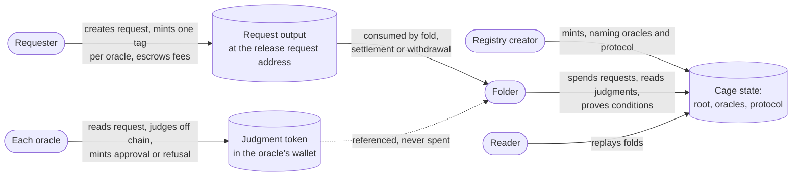

# Permissionless multi-oracle registries

!!! info "Design stage"
    This section describes a design that is decided, modelled in Lean and
    independently audited, but **not yet implemented** in the validators.
    The shipped cage is described under [Architecture](../../architecture/overview.md).
    Implementation is tracked by the milestone
    [Permissionless multi-oracle registries](https://github.com/cardano-foundation/cardano-mpfs-onchain/milestone/3).

## Who this is for

**As anyone who wants a shared, verifiable key-value registry on Cardano, I
want to create one by naming the oracles that judge it and the protocol they
judge, so that I need no script, no owner and no folding infrastructure of my
own, and anyone can fold what my oracles have approved.**

The shipped cage has a single privileged party: its owner is the only one who
can fold requests into the tree, and a per-cage request script holds every
request. This design removes both. A registry becomes a piece of data that
names its judges; one request script per release serves every registry; and
folding becomes a permissionless service anyone can offer.

The people involved and what each one gets:

| Who | Wants | Sees when it works | Sees when it is refused |
|---|---|---|---|
| Registry creator | A registry whose rules are fixed forever | A cage state with an empty tree, its oracles, its protocol and optionally a rule | Creation fails if the registry has neither an oracle nor a rule, or repeats an oracle |
| Requester | One write applied under conditions they choose | Their write folded into the tree, their fees paid to the oracles, the rest bid to the folder | A refusal, or a fold whose conditions do not hold; after the deadline they settle and recover the rest |
| Oracle | To be paid for judging, whatever it decides | Its fee credited to its balance at the fold, or at the complete account after the deadline, and collected by claim when it chooses | Nothing to refuse: an oracle that does not serve a registry simply never answers |
| Folder | To earn the remainder of requests it folds | Approved requests applied, the remainder of each request paid to it | A fold with a missing approval, a false condition or a late time is rejected |
| Reader | The registry's current contents | The tree rebuilt by replaying folds, with every write in a request datum | Nothing hidden: every write and every judgment is on chain |

## The system at a glance

Every arrow into the cage state goes through the fold. Judgments are minted
by reference to the request, so oracles never compete for the same output.
The request output is spent exactly once, by one of three exits, each in its
own time window.

## Reading route

1. [Request lifecycle](lifecycle.md): the states of a request, its three time
   windows and a sequence diagram for every exit.
2. [Decisions](decisions.md): every design choice with the alternatives it
   rejected and why.
3. [Economics](economics.md): who pays whom, the markets this opens, and the
   shipped cage as a special case.
4. [Oracle identities](oracles.md): oracles as keys or groups with shares,
   and how fees reach each key.
5. [Oracle slots and check protocols](slots.md), a draft: which oracle judges
   which keys under which published check, worked through on the moog
   registry.
6. [Formal model and audits](formal-model.md): what is proved in Lean, what
   the independent audits found, and what is not yet covered.

The authoritative decision record is
[`specs/request-approval-fold/decisions.md`](https://github.com/cardano-foundation/cardano-mpfs-onchain/blob/main/specs/request-approval-fold/decisions.md);
these pages explain it.
