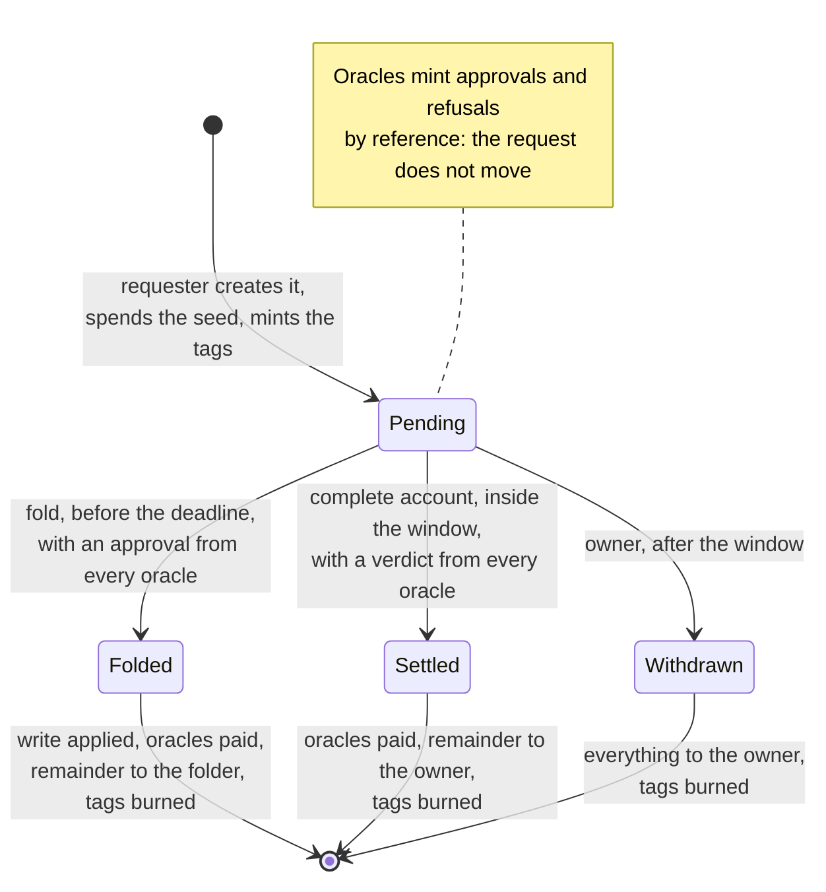
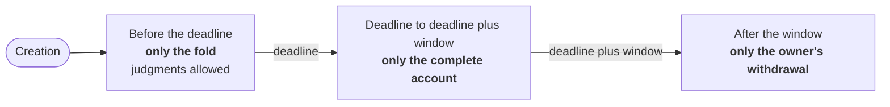
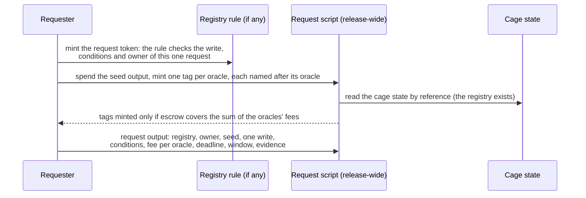
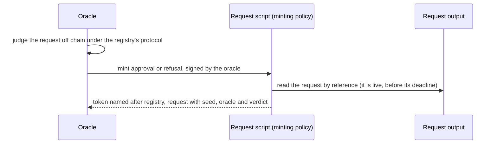
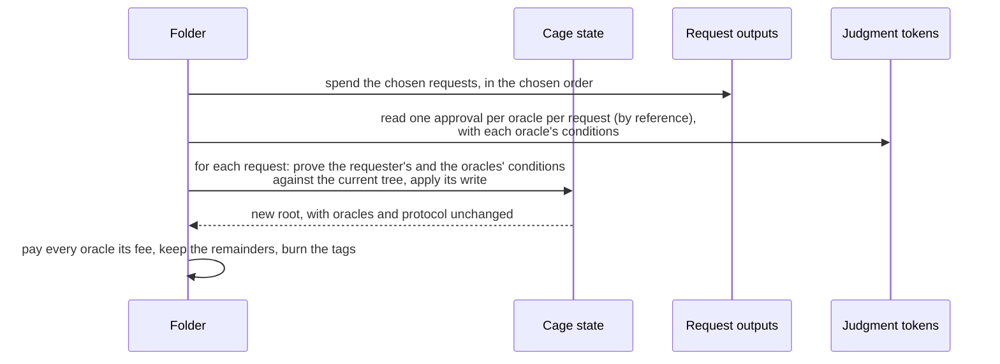
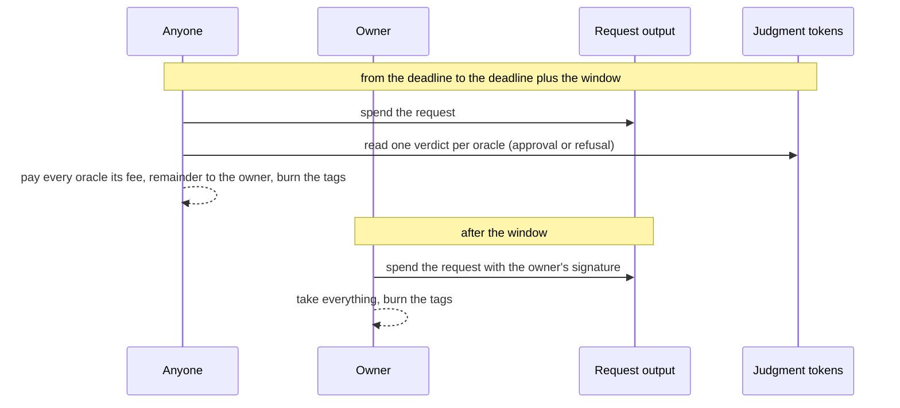

# Request lifecycle

**As a requester, I want to know at every moment which single exit can end
my request, so that no race between parties decides its fate.**

A request lives from its creation until exactly one of three exits consumes
it: the fold, the complete account (settlement), or the owner's withdrawal.
Which exit is possible depends only on the time, measured against the
request's own deadline and window, both chosen by the requester.

## States of a request

Judging never moves the request: each oracle mints its verdict into its own
wallet with the request output as a reference input. A request with several
oracles therefore has no contention while it is being judged.

## One exit per window

| Window | The only exit | What it needs | Who is paid |
|---|---|---|---|
| Before the deadline | Fold | An approval from every oracle of the registry (or the oracle's signature on the fold), and every condition true against the tree at that point of the fold | Every oracle its fee; the folder the remainder |
| From the deadline to the deadline plus the window, both included | Complete account | A verdict from every oracle, approvals and refusals in any mix | Every oracle its fee; the owner the remainder |
| After the window | Owner's withdrawal | The owner's signature | The owner everything |

The windows are disjoint and together cover all time, so exactly one exit is
possible at any moment. Several folders may still compete for the same cage
state, and several parties may submit the same settlement, but the outcome
for the request never depends on who submits first: a settlement pays the
same whichever verdicts it shows.

A refusal is therefore no early exit. It is the signed record of why the
oracle declined, and the evidence a settlement needs; a refused request waits
for its deadline, which its requester chose.

## Creating a request

The seed is an output reference spent by the creating transaction. No two
requests in history can carry the same seed, so no judgment can ever be
replayed onto a copied request.

## Judging

An oracle may also skip the separate judgment and sign the fold itself; its
signature counts as its approval of every request in that fold. A registry
with one oracle that folds its own requests therefore needs one transaction
per batch, as the shipped cage does.

## Folding

The folder chooses which approved requests to fold and in what order. It
cannot apply an unapproved request, change a write, skip a request it
consumed, or fold the same request twice.

## Settling and withdrawing

After the window the chain cannot tell a silent oracle from an approval the
owner chooses not to show, so the owner takes everything and decides whether
to pay the oracles that answered. A silent oracle loses its fee; that is the
price of not answering.

## Dead judgments

Once a request has been consumed its seed can never occur again, so any
judgment still naming it is worthless. Its holder may burn it at any time,
without the request or the cage taking part.
