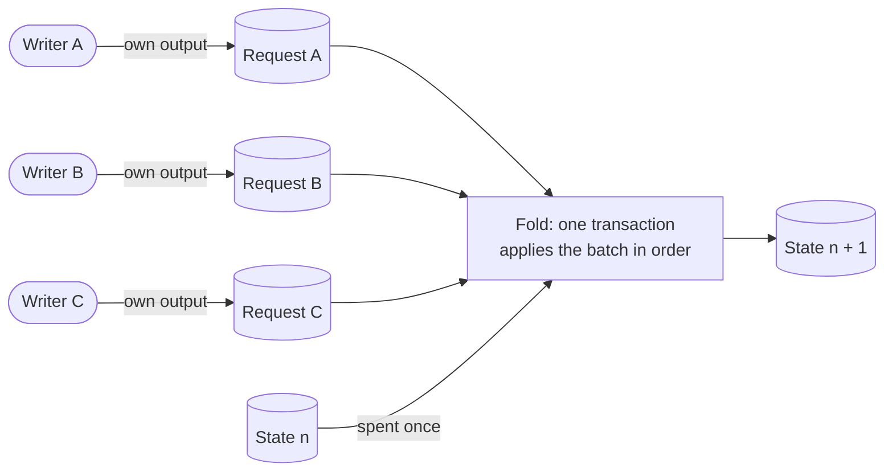
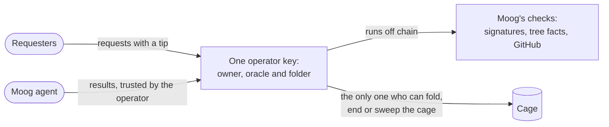
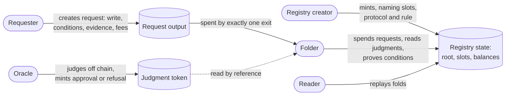
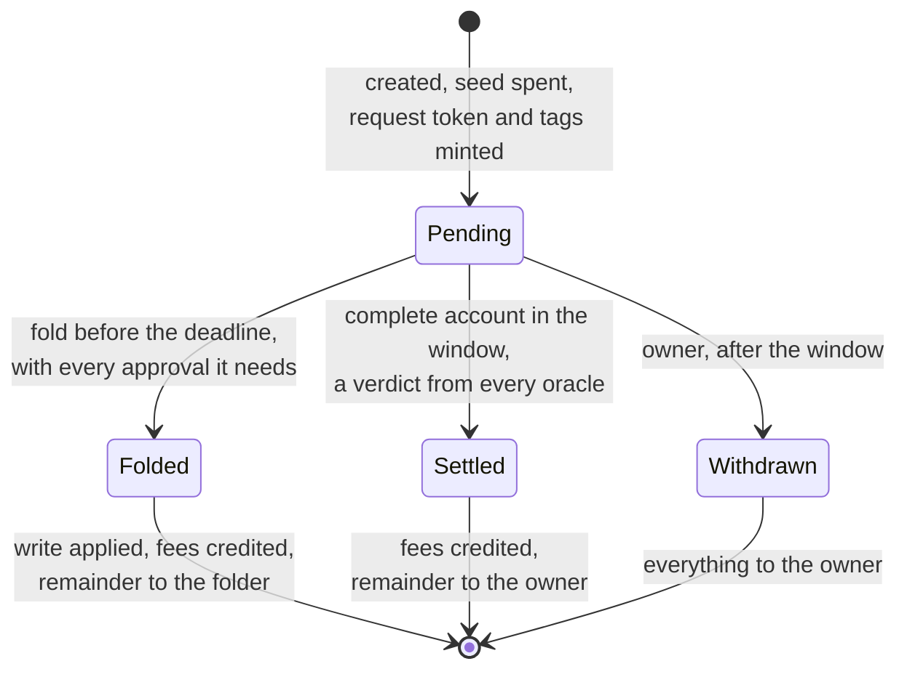
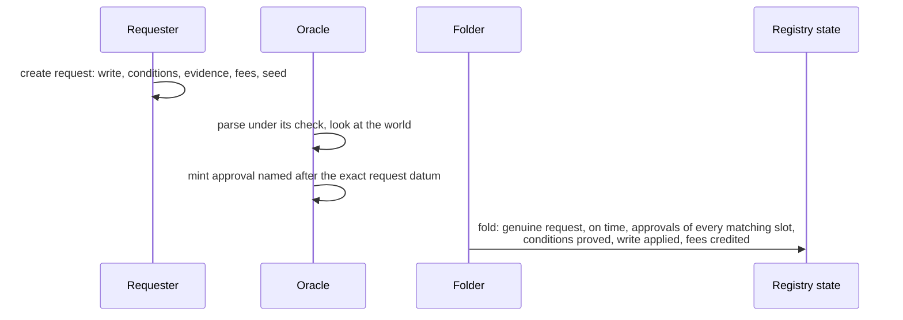
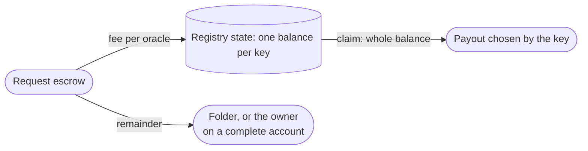
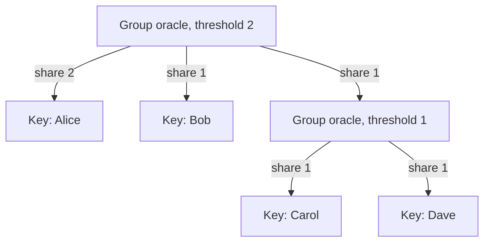
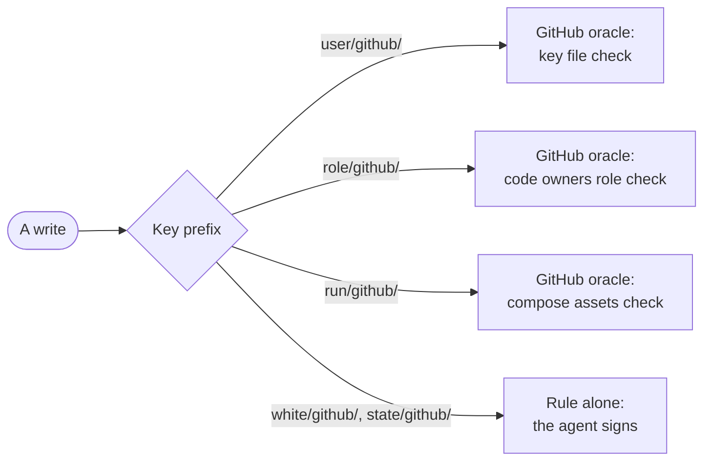
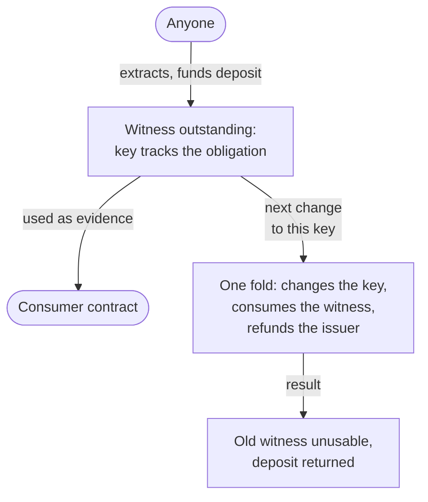

# Open MPFS: design document

**As anyone who wants a shared, verifiable key-value registry on Cardano, I
want to create one by naming the oracles that judge it and the checks they
perform, so that the registry needs no owner, no script of its own and no
folding infrastructure, its rules can never be changed under its users, and
anyone can fold what its oracles have approved.**

This document gathers the decisions taken from 24 to 27 October 2026 on open
MPFS: Merkle Patricia Forestry registries without an owner, judged by
independent oracles and folded by anyone. Each section says what is decided,
what is a draft whose direction is agreed but whose details are still moving,
and what is open.

| Status | Meaning |
|---|---|
| **Decided** | Recorded in the decision records; the earlier part is modelled in Lean and audited |
| **Draft** | Direction agreed in discussion; details may still change |
| **Open** | Not decided |

The decision records are the authority; this document explains them:

- [`specs/request-approval-fold/decisions.md`](https://github.com/cardano-foundation/cardano-mpfs-onchain/blob/main/specs/request-approval-fold/decisions.md):
  requests, judgments, folds and money;
- [`specs/oracle-identity/decisions.md`](https://github.com/cardano-foundation/cardano-mpfs-onchain/blob/main/specs/oracle-identity/decisions.md):
  oracle identities and how fees reach keys;
- [`specs/oracle-slots/decisions.md`](https://github.com/cardano-foundation/cardano-mpfs-onchain/blob/main/specs/oracle-slots/decisions.md):
  slots and check protocols, the draft.
- [`specs/durable-witnesses/decisions.md`](https://github.com/cardano-foundation/cardano-mpfs-onchain/blob/main/specs/durable-witnesses/decisions.md):
  durable witnesses of registry facts.

## Shared state needs folding

The hard problem here is not the Merkle Patricia Forestry. It is shared
state on Cardano.

A registry is one piece of state that many people want to change. On Cardano
that state lives in a single output, and changing it means spending that output
and creating its successor. Only one transaction can spend an output. If two
people each build a transaction that updates the registry, the first one in a
block wins and the other is rejected, because the output it spent no longer
exists. With many writers, almost every direct update would fail.

With a Merkle Patricia Forestry it is worse. A write carries a proof built
against the root the writer last saw. When another update lands first, the
root changes and the proof is stale: the loser must fetch the new tree,
rebuild its proof and race again, against everyone else doing the same.

So writers do not touch the state, and do not build proofs. Each writer creates a **request** in an
output of its own, where it contends with nobody. Then one transaction spends
the state together with a batch of requests and applies them all, in order,
producing the next state. That transaction is a **fold**.

The folder builds every proof at fold time, one after another, each against
the root left by the previous write, so the proofs are right by construction.
A writer only states its write and the conditions it expects of the tree; the
folder proves them. The Merkle Patricia Forestry makes the state small enough
to live in one output, a root hash, and makes each write checkable with a
short proof; any shared state on Cardano, with or without a tree, needs the
same folding pattern.

Folding answers contention and raises two questions in its place: who folds,
and who decides which requests may be folded. MPFS today answers both with
one key. Open MPFS answers them with services anyone can run.

## Why open MPFS

MPFS today is a registry with a keeper. One key owns the cage, judges every
request, and is the only party allowed to fold. The design makes the keeper
unable to cheat the tree, but not unnecessary: every write waits for it, every
rule lives in its private code, and running it is a cost its operator carries
for the sake of its own application. Open MPFS turns that keeper into a set of
services anyone can offer and be paid for. Two experiences led here.

### What moog taught

Moog runs its registry on the shipped cage. Reading what its oracle actually
checks shows five things.

- **One key does three jobs.** The owner is the oracle and the only folder; it
  can also end the cage. If its operator stops, nothing moves, and nobody else
  may step in.
- **Every check is off chain, in one program, even those the chain could
  make.** The oracle checks the requester's signature, that a role or a
  white-listing exists, that test runs are numbered in order, that results
  come from the agent. The chain could check all of these with signatures and
  tree conditions; instead readers trust that one program ran them. Only the
  GitHub lookups truly need an oracle.
- **Generic checks are locked inside one application.** "This GitHub user
  publishes this key" and "this repository's code owners name this user" are
  useful to many registries, but they exist only as moog's oracle code, run by
  moog's operator, for moog.
- **Running the oracle is a cost, not a business.** The requester's tip pays
  for the folding transaction. The operator runs the oracle because it needs
  the registry, so nobody outside the application has a reason to run one,
  and nobody can compete to run it better or cheaper.
- **Unaccepted requests are never refused.** Moog's oracle has no refusal: a
  request it will not accept stays in the cage, checked again at every poll,
  until its owner retracts it, and the requester learns nothing about why.

### What permissionless Singular taught

Singular, a permissionless mint of unique names over a Merkle Patricia
Forestry registry, went through the same move first.

- **Anyone can fold, from public data alone.** Singular's folds need no signer
  and no privileged folder; the request's remainder is the folder's bid, so
  folding is a market instead of a duty.
- **No one keeps power over a registry after creating it.** Singular has no
  authority to update parameters or migrate a registry; whoever could would
  hold power over every name in it.
- **What a creator declares unchecked becomes an attack.** Singular's creators
  wrote policy references into the registry that creation did not check, and
  a forged one let someone mint a live name outside any fold. Everything a
  creator declares must either be checked or be the registry's identity, named
  by hash.
- **Admission belongs to the application, not to the protocol.** Singular's
  investigation (lambdasistemi/singular#731, #741) moved the request lifecycle
  out of the protocol and into the application, which keeps the protocol small
  and provable. In open MPFS the application is the registry's rule and its
  oracles; the protocol only folds what they admitted. Open MPFS keeps one
  generic request lifecycle for every registry, because oracles must be paid
  for judging even when nothing is written.
- **No state outside the tree.** Per-key tokens held outside Singular's
  registry were where its forgeries lived; open MPFS keeps everything in the
  tree.

### From a keeper to services

| | MPFS today | Open MPFS |
|---|---|---|
| Who may fold | The owner | Anyone, paid by the request's remainder |
| Who judges | The owner's oracle | Independent oracles, named per slot, each paid per judgment |
| Where the rules are | One private program | Signatures in the rule, tree facts in conditions, only outside-world facts in oracles |
| Who can change or end the registry | The owner | No one |
| A request that is not accepted | Waits until its owner retracts it | Refused and paid for, with the refusal on chain |
| Why someone runs an oracle | To have their own registry | To earn fees from every registry that names it |
| Reusing a check | Copy the code | Name the same check protocol and provider |

The parties who care about a registry each run the piece they are good at,
in the service of requesters. A team that needs a registry declares its rule
and picks its providers, once. Whoever can verify something about the world,
such as a GitHub identity, publishes a check and serves it to every registry
that wants it, for a fee. Whoever runs an indexer and a node folds, for the
remainder. Requesters pay each of them for exactly the work done, and no one
of them can stop, redirect or rewrite the others.

## The system at a glance

Two words carry the whole design. A **registry** is a key-value database
together with its rules: what users create, write to and read. Its **registry
state** is the one output on chain, marked by a unique token, that holds the
database's root hash, its slots, protocol and rule, and the oracles' fee
balances. The database itself lives off chain, rebuilt by anyone from the
writes recorded on chain. The shipped design calls the registry state the
cage.

The shipped cage has one owner that alone folds requests, and one request
script per cage. Open MPFS removes both. A registry is data naming its
judges; one request script per release serves every registry; folding is a
service anyone can offer and be paid for.

| Who | Wants | Does |
|---|---|---|
| Registry creator | A registry whose rules are fixed forever | Names the slots, the protocol and the rule, once |
| Requester | One write applied under conditions they choose | Creates a request carrying the write, the conditions, the evidence and the fees |
| Oracle | To be paid for judging | Judges off chain, mints an approval or a refusal, collects its fees by claim |
| Folder | The remainder of the requests it folds | Applies approved requests to the tree, proving their conditions |
| Reader | The registry's contents | Rebuilds the tree by replaying folds; every write is on chain |

## Registries

**Decided.**

- **Anyone can create a registry.** Creation mints the registry state with an
  empty root, the oracles, the protocol and optionally a rule. No script is
  applied to a registry.
- **A registry needs at least one oracle or a rule.** A registry with neither
  would accept any write.
- **Everything is declared at creation and never changes.** Whoever could
  change a part would hold power over everyone who trusted the registry. The
  oracles and the protocol are the registry's identity: new judges mean a new,
  empty registry.
- **A registry has no owner and no end.** Its oracles are its only judges. A
  registry whose oracles stop answering stops moving.
- **Oracles need not consent to being named.** Naming is an offer of business;
  an oracle that does not want it never answers.

## Who checks what

**Decided**, with the slot row a draft. A registry defends itself in four
layers, each blind to what another sees:

| Layer | Runs | Defends against | Blind to |
|---|---|---|---|
| Rule | Once, when the request is created | The wrong writer (signatures), malformed writes, writes without the conditions they need (it demands them) | The tree and the outside world |
| Conditions | At the fold, at the request's turn | Stale, out-of-order or duplicated writes | Anything not in the tree |
| Oracles in slots | Off chain, attested by a judgment | False claims about the outside world | Keys outside their slots |
| The fold | Every fold | Forged requests, late folds, altered bytes, missing approvals, false conditions | Meaning: it checks bytes, hashes and proofs |

Under all four lies immutability: no one can switch them off later.

- **An oracle is needed only where the chain cannot see the data.** Signatures
  belong to the rule; facts about earlier writes are conditions; only the
  outside world needs an oracle.
- **A service that only reports its own work is a key in the rule, not an
  oracle.** Its writes are trusted because it signed them; the registry limits
  where it may write and that it cannot overwrite.
- **The `equals` condition ties a signer to the tree.** A rule can demand "the
  user's registered key equals the key that signed", so an earlier
  registration authorizes a later request with no oracle.
- **Rules are compiled minting policies**, named by hash in the registry state,
  minting the request token, so they run exactly once, at creation, on one
  request. They reach the tree only by demanding conditions.
- **The condition language is `absent`, `present` and `equals`**, each costing
  one Merkle Patricia Forestry proof in the fold.

## Requests

**Decided.**

- **A request carries one write**, `set key value` or `unset key`, on chain in
  its datum, so readers rebuild the tree for free.
- **A request carries conditions**, checked at the fold against the tree at its
  turn. Compare-and-swap is a write with a condition on its own key.
- **A request carries evidence**, opaque to the chain; the protocol decides
  whether it holds the evidence or its hash.
- **A request carries a seed**, an output spent by its creation, so no two
  requests in history are equal and no judgment can be replayed.
- **A request carries a deadline and a window**, which divide its life into
  three periods, each with exactly one exit.
- **A request carries one request token**, minted by the rule or the release
  policy at creation. It is what makes a request genuine; folders find a
  registry's live requests with one query by it.
- **A request carries one tag per oracle**, named after the oracle, so an
  oracle finds all its work across every registry with one query.

| Period | The only exit | Who is paid |
|---|---|---|
| Before the deadline | A fold applying the write | Oracles their fees; the folder the remainder |
| From the deadline to the deadline plus the window | A fold settling it by complete account | Oracles their fees; the owner the remainder |
| After the window | The owner's withdrawal | The owner everything |

## Judgments

**Decided**, with the trimmed minting checks a draft.

- **An oracle approves or refuses by minting a token** under the release
  policy, by reference to the request. Nothing is spent, so oracles never
  contend for an output.
- **The policy computes the token's name** from the registry, the complete
  request datum, the oracle, the verdict, the members of a group oracle that
  signed and, for an approval, the oracle's conditions. The oracle chooses its
  verdict, its conditions and who signs; it cannot produce a name for content
  it did not see.
- **An approval may carry the oracle's conditions**, the assumptions it judged
  under; the fold proves them at the request's turn.
- **A fold signed by an oracle counts as its approval**, so an oracle that
  folds itself needs no separate judgment.
- **Approving and refusing pay the same**, so an oracle gains nothing by its
  verdict.
- **Equivocation is accepted.** An oracle can mint both verdicts; under the
  periods above it changes nothing, and both stay on chain under its
  signature.
- **Draft: minting checks only what the fold cannot.** The policy needs the
  preimage of the name, to see which oracle it claims; the oracle's
  authorization; and a time before the request's deadline, so that no oracle
  is paid by a complete account for a judgment made too late. Whether the
  oracle belongs to the registry is left to the fold, which matches names
  against its own slots. A judgment then needs no reference to the registry state,
  which every fold spends, so judging never races folding.

What the fold checks for each request, in order:

1. The request carries the registry's request token, and the fold's validity
   interval falls before its deadline.
2. Which slots match: each slot whose prefix starts the written key, by byte
   comparison. No CDDL is read on chain.
3. For each matching slot, a judgment token whose name the fold recomputes
   from the request it spends, the slot's oracle and the conditions and
   signers given in the redeemer; or that oracle's authorization of the fold.
4. Every condition, the requester's and each approval's, against the tree at
   this turn, by proof.
5. The new root after the write.
6. Each matching slot's fee, credited to the signers of its judgment.

## Money

**Decided.**

- **The request pays for judgment, not for outcome**, declaring a fee per
  oracle.
- **Fees accumulate in the registry state.** Paying each oracle in its own output would
  cost the ledger's minimum per oracle per request. The registry state keeps a balance
  per key and holds their sum.
- **Only a fold spends the registry state.** Everything that changes it is an item of a
  fold, so nothing races the fold:

| Fold item | When | Effect |
|---|---|---|
| Write request | Before its deadline | Applies the write, credits the fees, remainder to the folder |
| Complete account | In its window | Writes nothing, credits the fees, remainder to the owner |
| Claim | Before its deadline | Pays one key's whole balance to the destination the claim names |

- **An oracle collects its fees by claim**, a request created with its key's
  signature that names the payout address and datum. The folder cannot choose
  the payout; the fold checks it exactly.
- **The escrow exceeds the fees by the ledger's minimum**, so a complete
  account can always refund the owner.

## Oracle identities

**Decided.** The oracle identity is a standard of its own, which open MPFS
consumes and which may move to its own repository.

- **An oracle is a key or a group**: a threshold and members, each a key or a
  group, each with a share. Groups nest.
- **Its identity is the hash of its description** and never changes. Keys are
  not rotated: a group that loses members beyond its threshold is dead, and
  its users name a new identity in a new registry.
- **A key authorizes by signing; a group when its threshold of members
  authorize**, recursively. The description travels in the redeemer; one
  library function checks it for every contract, rules included.
- **Only the members that signed are paid**, by their shares, down to keys.
  The signers are bound in the judgment's name. The integer remainder goes to
  the first signer.
- **A key stolen compromises only its oracles, up to their thresholds.** A
  registry naming several oracles already needs all of them; a single oracle
  protects itself with a group.

If Alice and Carol sign a judgment whose fee is 9, Alice is paid 6 and Carol
3; Bob and Dave, who did not sign, are paid nothing.

## Slots and check protocols

**Draft**, except where marked decided.

- **A registry names its oracles in slots**: an oracle identity, the hash of a
  check protocol, a key prefix and parameters.
- **A write needs approval only from the slots whose prefix matches its key.**
  Keys under no slot are gated by the rule alone; a registry without a rule
  refuses them. When several slots match, all must approve.
- **A check protocol is a document named by hash**, published by whoever
  writes the checking software: what is checked, the parameters, the shape of
  the key after the prefix and of the value, in CDDL. A new version is a new
  hash.
- **Under a slot's prefix the registry imports the check's shapes**; the rule
  may only narrow them.
- **A registry protocol ships a request zoo**, one sample per kind of request,
  validated before creation against each slot's check, its parameters and the
  rule. A passing zoo means the registry engages its checks correctly.
- **An oracle reads slots, not registry documents.** It engages a slot when it
  implements its check, accepts its parameters and the fee meets its price.
- **Decided: liveness is incentivized, not enforced.** A silent oracle stalls
  its slots and nothing replaces it, since a fallback judge would reintroduce
  an owner. Answering is what earns. A creator protects a registry by choosing
  providers, or by naming a group of competing providers whose threshold
  trades liveness against agreement.
- **Decided: creating a registry is a challenge to its oracles.** Nothing is
  negotiated beforehand; a slot proves to be served when its kinds of request
  are judged. A creator probes each slot and abandons a silent registry at the
  cost of its creation.

With slots, "every oracle" in the sections above reads "every oracle whose
slot matches the key": tags, approvals, complete accounts and fees follow the
matching slots.

### Worked example: moog

Moog lets GitHub users request test runs on Antithesis. Its registry splits
into three GitHub slots and two prefixes gated by its rule alone:

A test run needs the GitHub oracle only to confirm that the commit and its
compose file exist. That the requester holds the role, that the repository is
white-listed, that the requester's registered key signed and that runs are
numbered in order are conditions and rule checks. The agent's acceptances and
results need no oracle: the rule checks the agent's signature and a condition
checks the previous state. The CDDL for the slots, the checks and the moog
protocol is on [Oracle slots and check protocols](slots.md).

## Durable witnesses

**Decided.**

A consumer proving a fact about one key references the registry state and
its root. A fold writing any other key spends that output and changes the
root, so the consumer must rebuild its proof although its fact still holds.
Durable witnesses remove that dependence on unrelated writes.

- **A witness attests one fact about one key**: absent, present, or holding
  an exact value.
- **Anyone extracts one by funding its deposit**, and is its issuer.
- **It stays usable until the next change to its key.** Writes to other keys
  leave it usable and its deposit in place.
- **The registry tracks the obligation per key, and every fold complies.** The
  next change to a tracked key consumes its witness and refunds the deposit to
  the issuer in the same fold; otherwise the fold is invalid. A value change
  consumes a presence witness even when the key stays present.
- **A key has at most one witness, kept in the trie.** A key is unwitnessed,
  holding its value or with no entry when absent, or witnessed, when its entry
  is the witness: the attested value or absence and the refund address. A
  witnessed absence reads as absent to conditions and readers.
- **Extraction is a request that needs only its deposit**, with no rule and
  no oracle, folded like a write, that turns the key's entry
  into a witness. The next `set` or `unset` on the key proves that entry,
  burns the witness and pays the deposit to the refund address.
- **Extraction commits to the value it wants**, or to absence, and is folded
  only when the key is unwitnessed and holds exactly that at its turn.
- **The folder burns, writes and mints in one transaction.** It burns the
  old witness token, changes the tree and, when the request asks, mints the
  new witness token, so a witnessed entry always has exactly one live token.
- **Witness tokens sit at the registry state's address**, each in its own
  output funded by its deposit. A consumer references it; only a fold spends
  it.
- **A `set` request can include the witnessing**: it writes the value and
  leaves the key witnessed with it, refunding any earlier witness in the same
  fold.
- **The deposit is separate** from oracle fees, the folder's remainder and
  the request owner's refund.
- **A witness attests what the registry records**; its outside-world meaning
  still rests on the rule and the oracles.

This follows Singular's second product milestone, whose presence, absent and
terminal witnesses introduced proof durability.

## Alternatives rejected

| Decision | Chosen | Rejected | Why |
|---|---|---|---|
| Who folds | Anyone | The registry's owner | An owner is a single point of control and failure |
| Changing a registry | Never | Changeable oracles, prices or rules | Whoever may change them holds power over every user |
| Where the rule runs | Once, at creation, as the request token's minting policy | At every fold | The fold would traverse the whole batch to check what is fixed at creation |
| How judgments travel | Tokens minted by reference to the request | Off-chain signatures carried in the fold's redeemer (draft) | Tokens make the chain the meeting point, keep refusals on record and give the complete account its evidence |
| Where fees go | A balance per key in the registry state, claimed later | A fee output per oracle per fold | Each output costs the ledger's minimum, and small fees could not be paid at all |
| Who chooses an oracle's payout | The key, in its claim | The folder; a payout address fixed by a group | The folder could misdirect it; a majority could cut out a member |
| Who is paid in a group | The members that signed | Every member | A member that never judged would be paid for another's work |
| Oracle keys | Fixed identities, no rotation | Rotation by the group | Rotation needs a mutable identity, which is a power over every registry |
| What an oracle can be | Keys and groups of keys | A script credential | The chain sees a script act only through a zero withdrawal, a staking registration per oracle, or by spending its own output, an extra input per judgment |
| A silent oracle | Incentives only | A fallback judge after a timeout | A fallback judge is an owner |
| Equivocation | Accepted, public | A ballot per oracle burned at judgment | Under the three periods it changes nothing |

## Status and open questions

The decisions up to 26 October, the request, judgment and fold design with
rules and request tokens, are modelled in Lean and audited; see
[Formal model and audits](formal-model.md). The decisions of 27 October are
not modelled yet: oracle identities, fees in the registry state, complete accounts and
claims as fold items, durable witnesses, slots and the trimmed minting
checks. Nothing is
implemented in the validators yet.

Open:

- Whether prices are announced per check protocol, listing every provider of
  a check in one query, instead of per oracle.
- Whether the fee is declared per matching slot, and whether a judgment's
  name binds the slot, for an oracle in two slots matching one key.
- Whether oracles attest facts independently of any registry, valid until an
  expiry, so that one judgment of a world fact serves every registry that uses
  the same check; this would need its own payment path.
- The cost of prefix matching, condition proofs and fee splits in the fold, to
  be measured on a devnet.
- The migration or coexistence of existing cages.
