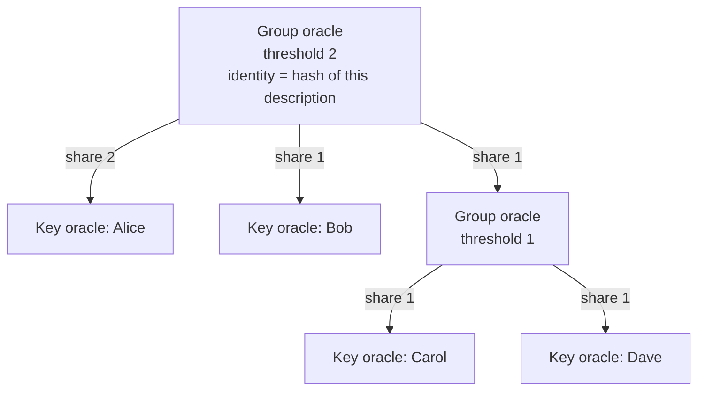
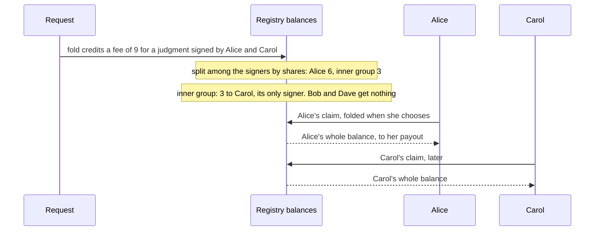

# Oracle identities

**As someone running an oracle, alone or with others, I want one on-chain
identity that any contract can name and check, so that a contract naming me
acts only on my authorization, and so that when I share the work with other
oracles each of us knows its share of the fees before serving.**

An oracle's key can be stolen. With one key per oracle, a stolen key is a
stolen oracle: the thief can approve whatever the oracle could. A registry
that names several oracles already needs every one of them to approve a
write, so one stolen oracle there can only block requests, never write. A
registry with one oracle, which is how the shipped cage works, has no such
protection.

The oracle identity is a standard of its own, recorded in
[`specs/oracle-identity/decisions.md`](https://github.com/cardano-foundation/cardano-mpfs-onchain/blob/main/specs/oracle-identity/decisions.md).
Registries consume it; it does not depend on them.

## Keys and groups

An oracle is a key, or a group: a threshold and a list of member oracles,
each with a share. In the group above, any two of Alice, Bob and the inner
group authorize, and the inner group authorizes when Carol or Dave signs. The
group survives one stolen key, and keeps working with one member silent.

The identity is the hash of the description, so it never changes. A contract
that names it trusts exactly those keys, thresholds and shares. Keys are never
rotated: a group that loses members beyond its threshold is dead, and its
users name a new identity in a new contract.

## Authorization

A key oracle authorizes a transaction by signing it. A group authorizes it
when at least its threshold of members authorize it, down to the keys. The
description travels in the redeemer; the checking script hashes it, compares
the hash with the identity it was given, and counts the signatures. One
library function does this for every contract that consumes the standard.

## Fees

A judgment records which members signed it, and only they are paid: the fee
is split among the signers by their shares at the moment it is credited, down
to keys, and each key collects its own balance by claim. No member can be cut
out by the others, because the shares are part of the identity, and no member
is paid for work it did not do, which matters when a group of independent
providers needs only one of them. The remainder of integer division goes to
the first member that signed.

No consent is needed on chain to describe a group: a member's key cannot
authorize anything without its own signature, so a group naming a member that
never agreed has one silent member. Serving is consent.

## Decisions

| Decision | Chosen | Rejected | Why |
|---|---|---|---|
| What an oracle is | A key, or a group with a threshold and a share per member, nested freely | One key per oracle; a script credential | One key is lost with its key. A script can only be seen acting through a zero withdrawal, which needs a staking registration per oracle, or by spending its own output, which adds an input to every judgment |
| An oracle's identity | The hash of its description, fixed | A mutable identity that its members can update | Whoever may change an identity holds power over every contract that names it |
| Key rotation | None; a dead group is replaced by a new identity in a new contract | Rotation by the group's threshold | Rotation needs a mutable identity |
| How fees reach a group's members | Split among the members that signed, by declared shares, down to keys; each key claims its own balance | A payout address chosen by the group; splitting among all members | Members in the majority could redirect a shared payout and cut out a member that did its work; in a group needing only some members, those that did not sign would be paid for others' work |
| Consent to being in a group | Not needed on chain; serving is consent | Every member signing the group's creation | An unwilling member cannot be made to sign anything, so naming it only adds a silent member |
| Where price notices live | One per oracle identity, minted and updated with its authorization | Prices fixed in the registry | Prices change; an oracle announces its own |

The cost of authorization and of fee splitting for deep or large groups is
not decided yet; it is to be measured on a devnet together with the fold
([#115](https://github.com/cardano-foundation/cardano-mpfs-onchain/issues/115)).
