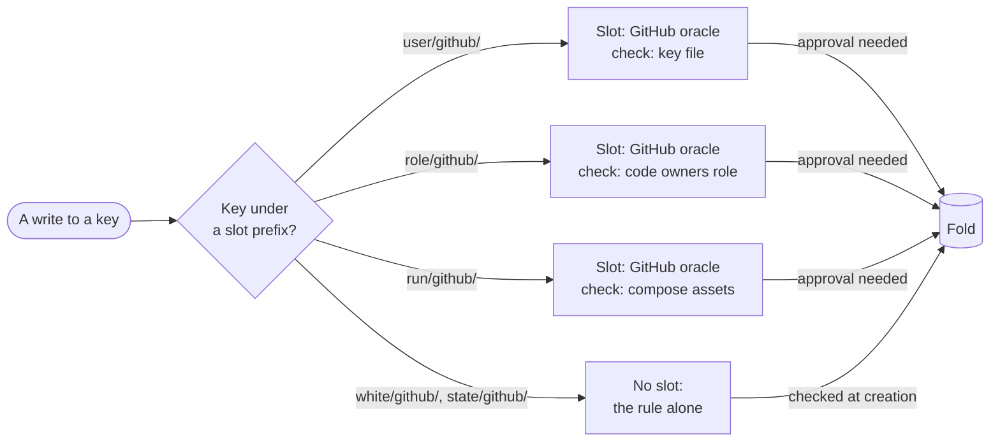
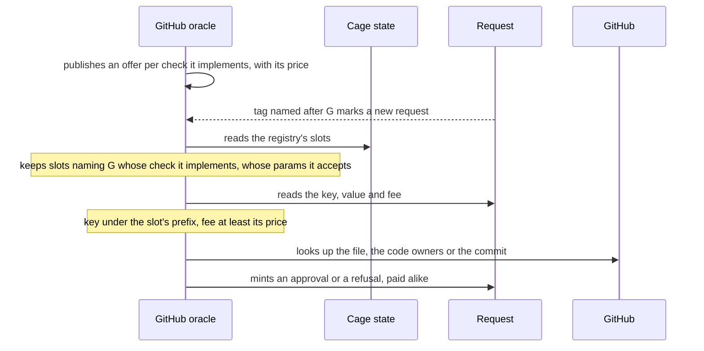

# Oracle slots and check protocols

**As someone creating a registry, I want to say which oracle judges which part
of my keys, and under which published check, so that I can combine
independent providers, keep parts of the registry gated by my rule alone, and
compare the providers of one check by price.**

!!! warning "Draft"
    This page works through a proposal, using the moog test-run registry as
    the example. Nothing on it is decided yet; the draft and its open points
    are in
    [`specs/oracle-slots/decisions.md`](https://github.com/cardano-foundation/cardano-mpfs-onchain/blob/main/specs/oracle-slots/decisions.md).

## The example: a registry for moog

Moog lets GitHub users request test runs on Antithesis. Its registry holds
users, roles, white-listed repositories, test runs and their states. Today one
oracle checks every write. Sorting those checks by what they need shows that
most of them need no oracle at all:

| Write | What must be true | Who checks it |
|---|---|---|
| Register a user | GitHub user `alice` publishes this key | an oracle, reading GitHub |
| Register a role | the repository's code owners file names `alice` | an oracle, reading GitHub |
| White-list a repository | the moog agent asks for it | the rule: the agent signs |
| Request a test run | the commit and its compose file exist | an oracle, reading GitHub |
| | duration within the allowed range | the rule |
| | the requester holds the role, the repository is white-listed | conditions: keys present |
| | the requester's registered key signed | the rule, with the condition that the user's key equals the signer |
| | runs are numbered in order | conditions: the previous run present, this one absent |
| Accept, reject or finish a run | the moog agent says so, after the previous state | the rule: the agent signs; a condition: the state equals the previous one |

The chain sees signatures, so they go to the rule, which runs when a request
is created. The fold sees the tree, so facts about earlier writes become
conditions. Only GitHub is out of sight, so only GitHub needs an oracle. The
Antithesis results need none: the registry trusts the agent's signature, as
moog does today, and adds only that the agent can write nowhere else and can
never overwrite a result.



## Slots

A registry names its oracles in **slots**. A slot is an oracle identity, the
hash of a check protocol, a key prefix and parameters for that check. A write
needs the approval of every slot whose prefix matches its key, and no other.
Keys under no slot are gated by the rule alone, and a registry without a rule
refuses them.

```cddl
slot = [
  oracle : bytes .size 32,  ; identity: hash of the oracle description
  check  : bytes .size 32,  ; hash of the check protocol document
  prefix : bytes,           ; the slot judges every write whose key starts with this
  params : bytes,           ; settings for this registry, read with the check's params rule
]
```

## Check protocols

A **check protocol** is published by whoever writes the checking software. It
fixes what is checked, the parameters a registry may set, and the shape of the
key after the slot's prefix and of the value. The registry chooses the prefix
and the parameters; the check defines the rest. Moog's three GitHub checks
would read:

```cddl
; check: github-file-key, version 1
; set   prefix ++ user = vkey  approved when GitHub serves file `params.file`
;                                in repository user/user, default branch, equal to hex(vkey)
; unset prefix ++ user         approved when that file no longer holds the registered vkey
params = [ file : tstr ]                        ; moog: ["moog.vkey"]
suffix = tstr .regexp "[A-Za-z0-9-]{1,39}"      ; a GitHub username
value  = bytes .size 32                         ; ed25519 verification key
```

```cddl
; check: github-codeowners-role, version 1
; set   prefix ++ org/repo/user = role  approved when the code owners file of org/repo,
;                                       default branch, has a line `<role>:` naming @user
; unset                                  approved when it no longer does
params = [ roles : [+ tstr] ]                   ; moog: [["antithesis"]]
suffix = tstr .regexp "[A-Za-z0-9-]+/[A-Za-z0-9._-]+/[A-Za-z0-9-]+"
value  = tstr                                   ; one of params.roles
```

```cddl
; check: github-compose-assets, version 1
; set prefix ++ org/repo/commit/dir/try  approved when the commit exists and dir, at that
;                                        commit, holds a compose file that `docker compose config` accepts
; unset or overwrite                     always refused: these keys are insert-only
params = []
suffix = tstr .regexp "[^/]+/[^/]+/[0-9a-f]{40}/[^/]+/[0-9]+"   ; dir percent-encoded
value  = any                                    ; not read by this check
```

The moog registry protocol is then the composition: its slots, and the
prefixes it gates with its rule.

```cddl
; registry protocol: moog, version 1
;
; slots (copied into the registry datum):
;   "user/github/"  github-file-key         params ["moog.vkey"]
;   "role/github/"  github-codeowners-role  params [["antithesis"]]
;   "run/github/"   github-compose-assets   params []
;
; prefixes gated by the rule only (agent key and durations fixed in it):
;   "white/github/" org/repo                          set by the agent
;   "state/github/" org/repo/commit/dir/try = state   set by the agent

run-value = [ requester : tstr, duration : uint, faults : bool ]
  ; rule: min <= duration <= max; the requester's key signs
  ; rule demands these conditions:
  ;   role/github/org/repo/<requester>   present
  ;   white/github/org/repo              present
  ;   user/github/<requester>            equals the signing key
  ;   run/github/.../<try>               absent
  ;   run/github/.../<try - 1>           present, when try > 0

state    = accepted / rejected / finished
accepted = [0]
rejected = [1, reasons : [* uint]]
finished = [2, outcome : bool, duration : uint, url : bytes]   ; url encrypted to the requester
  ; rule: the agent signs; condition: the state key equals the previous state
```

The run and its state live under different prefixes on purpose. Creating a
run needs the GitHub check; moving its state needs only the agent. Under one
prefix the GitHub oracle would be asked to judge results it cannot see.

## How an oracle engages

The oracle never reads the moog document. It reads slots, and the checks are
its own code.



Engaging needs no transaction. An oracle that does not implement a slot's
check, or does not accept its parameters, never answers it, and writes under
that prefix stop. A key or value that does not parse under the check is
refused, and the refusal is paid.

## The game

Each player chooses once or repeatedly, and the registry's immutability fixes
what can be undone:

| Player | Chooses | Gains | Can hurt the others by | Limited by |
|---|---|---|---|---|
| Check author | What a check verifies and its parameters | Providers adopt the check | A vague check whose verdicts nobody can audit | Verdicts and, if the protocol stores it, evidence are public |
| Provider | Which checks to implement and at what price | Fees for every judgment | Stopping, which stalls every prefix it holds alone | The creator can name a group of competing providers with threshold one |
| Registry creator | Prefixes, checks, parameters, providers, rule | A registry fixed forever | Choosing a provider that never engages | Probing each slot with one request of each kind after creating, and abandoning a silent registry |
| Requester | When to write and what fee to offer | The write applied | Nothing: a write is judged as written | Fees below the price are never judged |
| Agent named in the rule | What it writes under its own prefix | Trust it already had | False results, permanently signed by it | Its prefix, its group of keys, and conditions on the previous state |

Competition happens at two moments. When a registry is created, the creator
picks the cheapest or most trusted provider of each check. Inside a registry,
a slot whose oracle is a threshold-one group of providers of the same check
lets them race for each request; only the signer is paid, and any one of them
can approve alone.

## Liveness

Liveness is incentivized, not enforced. An oracle that stops answering stalls
every write under its slots, and nothing on chain replaces it, because a
fallback judge would reintroduce an owner. Oracles are paid for every
judgment, approving or refusing, so answering is what earns. A creator
protects a registry by choosing providers, and by naming a group of competing
providers of the same check, whose threshold trades liveness against how many
must agree. A registry whose oracles are gone is dead, and its users create a
new one.

Creating a registry is a challenge to its oracles. Nothing is negotiated
before creation: the creator names providers, checks and parameters, and the
providers answer or stay silent. Whether a slot is served is known only when
its kinds of request have been judged, so a creator probes each slot with one
request of each kind it expects, and abandons the registry, at the cost of its
creation, if a slot stays silent.

## Open questions

- Whether prices are announced per check protocol, listing every provider of
  a check in one query, instead of per oracle.
- Whether the fee is declared per matching slot, and whether a judgment's
  name binds the slot.
- The cost of the prefix comparisons in the fold, and the Lean model's change
  from a fixed oracle set to slots.
