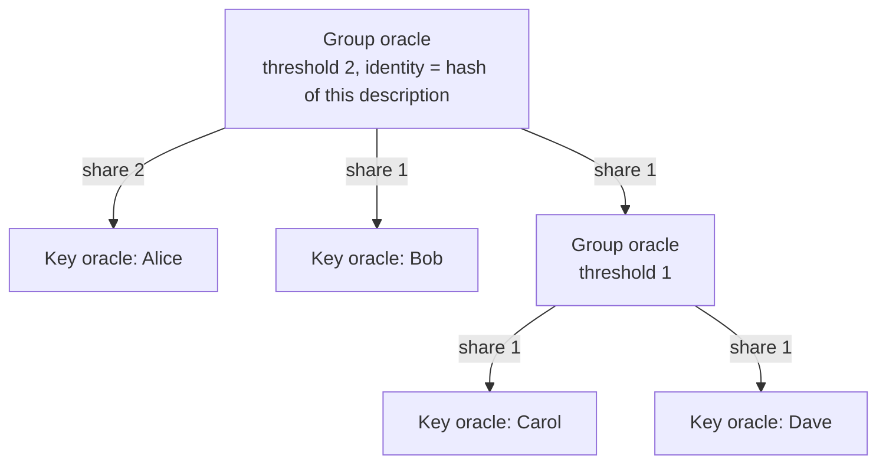

# Oracle identities: decisions

As someone running an oracle, alone or with others, I want one on-chain
identity that any contract can name and check, so that a contract that names
me can only act on my authorization, and so that when I share the work with
other oracles each of us knows its share of the fees before serving.

This records the decisions taken on 27 October 2026, while designing
permissionless multi-oracle registries
(`specs/request-approval-fold/decisions.md`). The oracle identity is a
standard of its own: Merkle Patricia Forestry registries consume it, but it
does not depend on them and may move to its own repository.

## Identities

- **An oracle is a key or a group.** A key oracle is one verification key. A
  group oracle is a threshold and a list of members, each of them an oracle
  (a key or another group) with a share. Groups may nest.
- **An oracle's identity is the hash of its description**: blake2b-256 of
  `serialise_data` of a tuple led by the role `oracle`, followed by the
  description. The identity never changes, because the description cannot
  change without changing the hash. A contract names an oracle by its
  identity.
- **A key that is stolen compromises only the oracles it belongs to, up to
  their thresholds.** A key oracle is lost with its key. A group with
  threshold `m` survives fewer than `m` stolen member keys; it stops working
  when more than `n - m` of its members are lost or silent.
- **Keys are never rotated.** A contract that names an identity trusts exactly
  the keys described by it. A group whose members are lost beyond its
  threshold is dead; its users name a new identity in a new contract. Rotation
  would need a mutable identity, and whoever may change it would hold power
  over every contract that named it.

## Authorization

- **A key oracle authorizes a transaction by signing it**: its key hash is
  among the transaction's required signers.
- **A group authorizes a transaction when at least its threshold of members
  authorize it**, recursively down to keys.
- **The description travels in the redeemer.** The checking script hashes it,
  compares the hash with the identity it was given, and walks the
  description against the transaction's signers. The cost grows with the
  number of keys in the description.
- **One library function decides authorization**, shared by every contract
  that consumes the standard.
- **A script credential as an oracle was rejected.** The checking script
  could only see another script act through a zero withdrawal or by spending
  that script's own output; the first needs a staking registration per oracle
  and the second puts an extra input in every judgment.

## Fees

- **Only the members who signed are paid.** A judgment records which members
  authorized it, down to keys, and a contract binds that record to the
  judgment so that it cannot be replaced. When the judgment's fee is credited,
  it is split among the members that signed, by their shares, recursively
  down to keys. Shares are part of the description, so every member knows its
  cut before serving and no member can later be cut out by the others. The
  remainder left by integer division goes to the first member that signed.
- **Paying members that did not sign was rejected.** In a group that needs
  fewer than all its members, for example two independent providers of the
  same check where either one suffices, a member that never judged would be
  paid for the other's work.
- **Fees reach keys, never groups.** A contract that pays oracles keeps a
  balance per key; each key withdraws its own balance to where it chooses.
- **A shared payout address chosen by the group was rejected.** Members in
  the majority could redirect the payout and cut out a member that did its
  share of the work.

## Consent

- **No on-chain consent is needed to describe a group.** A member's key
  cannot authorize anything without its own signature, so a group naming a
  member that never agreed simply has one silent member. Serving is consent:
  a member that does not want to be in a group never signs for it.

## Price notices

- **Each oracle keeps a price notice**, an output holding a price token named
  after its identity and minted with its authorization, whose datum carries its
  current fee, optionally per protocol. The oracle changes its price by
  spending and recreating the output with its authorization. The notice binds
  nothing; it is how a requester learns what an oracle asks before paying it.

## Not decided

- The cost of authorization and fee splitting for deep or large groups, to be
  measured on a devnet with the registry fold.
- Whether the standard moves to its own repository.

In this group any two of Alice, Bob and the inner group authorize; the inner
group authorizes when Carol or Dave signs. If Alice and Carol sign a judgment
whose fee is 9, Alice's share 2 and the inner group's share 1 split it into 6
for Alice and 3 for the inner group, all of which goes to Carol, its only
signer. Bob and Dave, who did not sign, get nothing.
