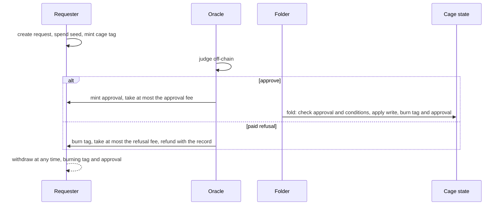

# Requests, oracle approvals and permissionless folds: decisions

As a cage operator, I want requests to reach my cage without a request script
applied to my cage, so that creating a cage publishes no per-cage script and
anyone can fold what I have approved.

This records the design decisions taken on 24 October 2026, after the Singular
investigation in which the request lifecycle belongs to the application
(lambdasistemi/singular#731, #741). The Lean statements in
`lean/MpfsCage/RequestApprovalFold.lean` state this design. Each decision says
what was decided and why.

## Roles

- **Three parties check three things.** The requester states the write and the
  conditions on the tree under which it may apply. The oracle states that the
  requester may ask for it: an authorization judged off-chain (for Moog: GitHub
  keys, repository roles, signatures), independent of the tree. The folder,
  anyone, shows that it applies to the tree now.
- **The oracle is the application.** In Singular's terms the MPFS oracle plays
  the application: it decides admission, not tree validity.
- **Folding is permissionless.** Whether a fold is accepted does not depend on
  who submits it. The folder chooses which approved requests to include and
  their order; it cannot apply an unapproved request, change a write, or
  consume a request without applying it.
- **No rejection.** The tree moves only by folded writes. A request that is
  not approved is simply never folded.
- **No externalized state.** Unlike Singular, the fold mints and burns no
  per-key token; everything stays in the tree. Generalizing to both designs is
  out of scope.

## Requests

- **One request script per release** serves every cage. It is the spending
  validator of the request address and the minting policy of the tags and
  approvals. No script is applied to a cage.
- **A request names its cage by data** (state policy and state asset name).
- **A request carries one write**: `set key value` or `unset key`.
- **A request carries conditions**: `key absent` or `key equals value`, on any
  key, checked at the fold against the tree reached when the request is
  applied. Compare-and-swap is a write with a condition on its own key; a
  blind write has no conditions and applies to any tree. Fold-time conditions
  are required because a generic system cannot foresee every state-based
  consideration of its applications.
- **The oracle checks that the conditions are sufficient** for its own rules
  before approving. The fold checks that they hold.
- **A request carries a seed**, an output reference spent by the transaction
  that creates it, so that no two requests in history are equal. An approval,
  or an application signature covering the seed, cannot be replayed onto a
  copied request.
- **The owner may withdraw at any time.** There is no clock on a request.
  Withdrawing burns its tag and its approval, so the approval dies with it.

## Discovery

- **The requester mints a tag** named after the cage, under the request
  script's policy, into the request output. The oracle finds its pending
  requests with one asset query.
- **Minting a tag** requires the seed to be spent in the same transaction and
  the cage state to be present as a reference input, proving that the cage
  exists. Exactly one tag goes into exactly one request output.
- **Every path that consumes a request burns its tag**, so a tag never leaves
  a request output and the asset query returns only live requests.
- **Folders find work through approval tokens.**
- The address staking-part alternative was declined.

## Approvals

- **The oracle approves by minting an approval token into the request
  output**, recreating the output with the same request and tags.
- **The approval's name** hashes the cage, the request (including its seed)
  and the expiry.
- **The approval expires**, at a time the oracle chooses: an off-chain
  judgment does not stay valid forever. A fold needs a live approval. An
  expired approval can be replaced by a fresh one.
- **Only the cage's oracle can approve**, checked against the oracle recorded
  in the cage state, read as a reference input.

## Money

- **The request pays for being judged.** It declares an approval fee; the
  oracle takes at most that fee at the first approval. Re-approval takes
  nothing, so an oracle cannot drain a request by approving it repeatedly.
  This protects the oracle from being starved by requests withdrawn after
  approval.
- **A paid approval must be foldable.** The request declares a minimum
  approval window; an approval must stay live at least that long after the
  approving transaction.
- **Paid refusal is opt-in.** A request may declare a refusal fee. If it is
  positive, the oracle may refuse the request before any approval: it burns
  the tag, takes at most the refusal fee and returns the rest to the request's
  refund address in an output whose datum records the refused request and the
  oracle's reason. The record is what the requester pays for. With a zero
  refusal fee the oracle cannot refuse for a fee, so it cannot target a
  requester by refusing.
- **The fold checks no money.** A request's remaining value is the folder's
  bid; any minimum is the oracle's policy at approval.

## Not decided

- Encodings of the hashed names (the Singular line uses CBOR specified in
  CDDL), the datum layout and the migration of existing cages.
- Fold cost: the cost per condition proof is to be measured on a devnet.

