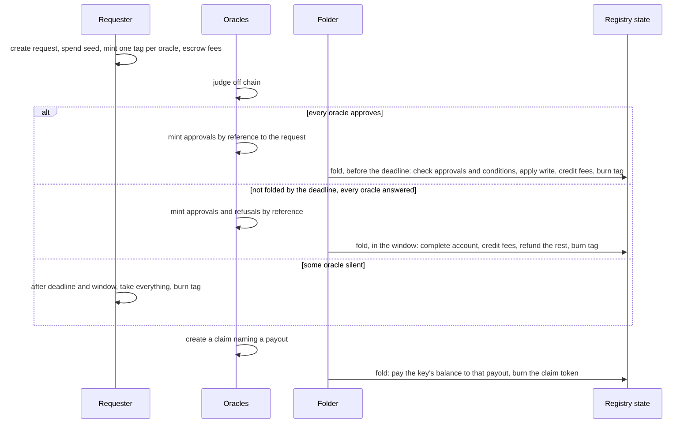

# Requests, oracle judgments and permissionless folds: decisions

As anyone, I want to create a registry by naming the oracles that judge it and
the protocol they judge, so that a registry needs no script, no owner and no
folding infrastructure of its own, and anyone can fold what its oracles have
approved.

This records the design decisions taken from 24 to 27 October 2026, after the
Singular investigation in which the request lifecycle belongs to the
application (lambdasistemi/singular#731, #741). Each decision says what was
decided and why. The Lean model under `lean/MpfsCage/RequestApprovalFold/`
states this record, except the decisions of 27 October (oracle identities,
fees accumulated in the registry state, complete accounts and claims as fold items),
which it does not model yet.

## Roles

- **Three parties check three things.** The requester states the write and the
  conditions on the tree under which it may apply. Each oracle judges, off
  chain, the aspect of the request it is responsible for (for Moog: GitHub
  keys, repository roles, signatures), independently of the tree. The folder,
  anyone, shows that the write applies to the tree now.
- **The oracles are the application.** In Singular's terms the oracles play the
  application: they decide admission, not tree validity. Different oracles
  check different things, so an application is composed from oracles, which
  may be shared between applications.
- **Folding is permissionless.** Whether a fold is accepted does not depend on
  who submits it. The folder chooses which approved requests to include and
  their order; it cannot apply an unapproved request, change a write, or
  consume a request without applying it.
- **Empty folds are allowed.** A fold that applies no request earns nothing
  and costs its submitter a transaction fee; folders are paid only by the
  requests they apply, so they keep the registry moving. Forbidding empty folds
  would only stop deliberate griefing, at the price of another check in every
  fold.
- **No externalized state.** Unlike Singular, the fold mints and burns no
  per-key token; everything stays in the tree. Generalizing to both designs is
  out of scope.

## Registries

- **Anyone can create a registry.** Creating one mints the registry state (the output the shipped design calls
  the cage) with an empty root, the set of oracles, the protocol and optionally a rule. No script
  is applied to a registry.
- **A registry needs at least one oracle or a rule.** With oracles, writes are
  gated by their judgment; with a rule, by the rule; with both, by both. A
  registry with a rule and no oracles is gated by its rule alone: for example a
  rule admitting only one owner's key gives a personal registry that anyone can
  fold. A registry with neither would accept any write and is not allowed.
- **Everything is declared at creation and never changes.** A permissionless
  registry cannot have changeable parts, because whoever may change them would
  hold power over everyone who trusted the contract.
- **The oracle set and the protocol are the registry's identity.** Every entry
  of the tree means "judged by these oracles under this protocol". Changing the
  oracles would leave part of the tree judged one way and part another, and no
  migration repairs that: a migrated tree carries the mix along. New judges
  mean a new, empty registry.
- **A registry has no owner and no end.** The oracles are the only judges and
  they only judge requests; a centralized power to end or freeze the registry
  above distributed judgment of requests makes no sense. A registry whose
  oracles stop answering simply stops moving. Trust is placed in the oracles
  when they are enumerated; nothing in the protocol can rescue a registry from
  a bad one.
- **Oracles need not consent to being listed.** Listing is an offer of
  business; an oracle that does not serve a registry never answers its
  requests.
- **An oracle is an identity of the oracle standard**
  (`specs/oracle-identity/decisions.md`): a key, or a group of oracles with a
  threshold and a share each. The registry names oracles by identity. Wherever
  this record says an oracle signs, the oracle authorizes under that standard:
  its key signs, or at least its threshold of members authorize. A registry
  that names one group oracle survives stolen keys below the group's
  threshold; a registry that names several oracles already needs every one of
  them to approve a write.
- **The protocol is named by hash.** The registry carries the hash of a
  document describing, in CDDL, its keys, values and evidence, and optionally
  which key prefix each oracle judges. Oracles publish off chain which
  protocols they serve. An oracle that does not understand a request does not
  answer it, so the protocol affects progress, never safety.

## Requests

- **One request script per release** serves every registry. It is the spending
  validator of the request address and the minting policy of the tags,
  approvals, refusals and claim tokens.
- **A request names its registry by data.**
- **A request carries one write**: `set key value` or `unset key`. The write is
  on chain in the request datum, paid for by the requester, so readers rebuild
  the tree by replaying folds at no cost. A protocol may store a hash as the
  value, in which case serving the preimage is the key holder's
  responsibility.
- **A request carries conditions**: `key absent`, `key present` or `key equals
  value`, on any key, checked at the fold against the tree reached when the
  request is applied. Compare-and-swap is a write with a condition on its own key; a
  blind write has no conditions. Fold-time conditions are required because a
  generic system cannot foresee every state-based consideration of its
  applications. The oracles check that the conditions suffice for their rules;
  the fold checks that they hold.
- **A request carries evidence**, an opaque field the chain never reads. The
  registry's protocol decides whether it holds the evidence itself or its
  hash, with the content delivered to the oracles off chain. Both have valid
  uses: on chain lets anyone audit the oracles' reasons; off chain is cheaper.
- **A request carries a seed**, an output reference spent by the transaction
  that creates it, so that no two requests in history are equal and no
  judgment can be replayed onto a copied request.
- **A request carries a deadline and a window.** Folds and judgments happen
  before the deadline. The owner cannot withdraw before the deadline plus the
  window, which protects oracles that have judged from losing their fee.

## Rules

- **A rule is a compiled minting policy**, named by its hash in the registry state
  state and fixed at creation. It is the minting policy of the registry's
  request token, so it runs exactly when a request is created, on that one
  request, and never at the fold. It validates the request datum (the write,
  the conditions, the owner) and the signatures of the creating transaction,
  and it allows every burn unconditionally so that exits never run it again.
  One rule script serves every registry that names it: the request token's name
  binds the registry, and the rule checks that the request datum names the
  same registry.
- **A rule reaches the tree only through conditions.** The tree is a root hash,
  so no rule can read it. A rule that depends on the tree demands the matching
  condition in the request (insert-only demands `key absent` on the written
  key); the fold then proves that condition against the tree at the request's
  turn. The rule validates the program; the fold executes it.
- **The condition language is `absent`, `present` and `equals`.** Each
  construct is a permanent cost in the fold, which is its interpreter, and each
  costs one Merkle Patricia Forestry proof. Predicates on values (thresholds,
  sets of statuses) were deferred until a registry needs them, because they add
  decoding to the fold; facts about key prefixes were rejected because per-key
  proofs cannot establish them.
- **A rule as a check run by the fold** was rejected: it would run on every
  fold and traverse the whole batch, while everything it can check is fixed in
  the request at creation. **A zero withdrawal at creation** as the trigger was
  rejected in favour of the minting policy: it needs a staking registration per
  rule and adds nothing.

## Request tokens

- **Every request carries one request token**, named after its registry and
  led by its role, minted at creation into the single request output at the
  release request address whose datum names that registry. It is minted by the
  registry's rule when the registry has one, otherwise by the release policy.
  One request is created per creation transaction.
- **The request token is what makes a request genuine.** It can only be minted
  through the creation checks, so a forged output at the request address cannot
  carry it, and the fold folds only request outputs carrying it. Tags no longer
  carry this role, which matters for a registry with no oracles and hence no
  tags. Every exit burns it.
- **Folders find work through the request token.** One query by the request
  token of a registry returns every live request of that registry. An
  approval's name binds the oracle's conditions, which the folder cannot know
  in advance, so the folder lists the registry's judgment outputs by the
  release policy and reads each one's datum; a refusal, or an approval without
  conditions, can also be looked up by its computed name. From the live
  requests and the authentic judgment outputs, nothing foldable is missed and
  nothing unfoldable is included.
- **The seed is checked when tags are minted.** It protects judgments from
  replay, so a registry without oracles, which has no judgments, needs none.

## Judgments

- **Every oracle of the registry must approve** a request before it can fold.
- **An oracle approves or refuses by minting a token** under the request
  script's policy, with the request output as a reference input. The token can
  sit in any output, typically the oracle's own wallet. Nothing is spent, so
  oracles never contend for the request output.
- **An approval may carry the oracle's own conditions**, in the same condition
  language. An oracle judges off chain against the tree as it saw it; its
  conditions state what it assumed ("approved, provided k is still pending"),
  and the fold proves them at the request's turn. An approval is therefore only
  usable while the oracle's assumptions still hold, which no expiry could
  achieve. Without this, an oracle whose rules the request's own conditions did
  not cover could only refuse.
- **A judgment's name** hashes the registry, the request (including its seed),
  the oracle, the verdict, the members of a group oracle that signed it and,
  for an approval, the oracle's conditions, so neither the conditions nor the
  signers can be detached or replaced. Only the signers of the judgment that a
  fold or complete account shows are paid; when a group has judged a request
  more than once with different signers, the party folding chooses which
  judgment to show. Judgments do not expire: the request's deadline bounds
  them, and an oracle that finds a deadline too far for its judgment to stay
  valid does not answer.
- **A fold signed by an oracle counts as that oracle's approval** of every
  request in it, so a single oracle that folds itself needs no separate
  approval transaction. Its conditions then travel in the fold's redeemer,
  which its signature covers.
- **The fold collects every condition of a request**: the requester's, from the
  request datum, and each approving oracle's, from its approval output read by
  reference and checked against the approval's name. It matches each condition
  to a proof in the redeemer and validates it against the tree at the request's
  turn, then applies the write. The folder pays for these proofs from the bid.
- **Dead judgments are harmless.** Once the request is gone its seed can never
  recur; the holder burns the token whenever it likes.

## Discovery

- **The requester mints one tag per oracle** of the registry under the
  request script's policy, all into the request output. Each tag is named
  after its oracle, so an oracle finds every pending request across every
  registry with one asset query, with no index of the registries that list
  it. Minting requires the seed spent in the same transaction and the registry state
  state as a reference input, proving that the registry exists. One tag per
  request named after the registry was rejected: an oracle would first have to
  find every registry naming it.
- **Every path that consumes a request burns its tags**, so an asset query
  returns only live requests.
- **Folders find work through request tokens** (see "Request tokens"), and
  find claims with one query by the claim token of a registry.
- The address staking-part alternative was declined.

## Prices, ordering and hold-up

- **Each oracle publishes an on-chain price notice.** It is an output holding
  a price token minted under the release policy with the oracle's signature
  and named after the oracle; its datum carries the oracle's current fee,
  optionally per protocol. The oracle changes its price by spending and
  recreating the output with a new datum; the token keeps its name. A wallet
  prices a registry with one asset query per oracle. The notice is not
  binding: an oracle can still ignore a request, but it then publicly
  contradicts its own signed notice. Prices in the registry's protocol
  document were rejected because that document is fixed by hash; prices on
  each oracle's own endpoint were rejected as unverifiable and undiscoverable.
- **Ordering by the folder is accepted.** When approved requests conflict, the
  folder's order decides which wins, and bids can buy that order. The loser
  costs its requester only the fees: its condition fails, it cannot fold, and
  it settles after its deadline. An application that wants fair ordering gets
  it from its oracles, which see every request and can approve only one of
  conflicting requests. First-come-first-served on chain was rejected: the
  chain cannot prove that an older approved request was skipped.
- **Hold-up by complementary oracles is accepted.** Each oracle can block a
  request by not answering until its price is paid, so the total price of
  judgment may exceed that of one integrated oracle. Since silence earns
  nothing and refusal pays the same as approval, holding out is only pricing.
  Fixed prices or a fee cap in the registry were rejected: an immutable
  registry would freeze them forever, and an oracle could still go silent.

## Encodings

- **Everything is specified in CDDL, describing the Plutus Data encoding.**
  Datums and redeemers are Plutus Data, laid out in Aiken's default
  constructor encoding. One CDDL file in the repository describes them and
  the preimages of hashed names, with test vectors pinning the exact bytes,
  including definite or indefinite lengths, so that off-chain encoders match
  the chain byte for byte.
- **A hashed name is blake2b-256 of `serialise_data` of a tuple whose first
  field is the token's role** (tag, approval, refusal, price, request or
  claim; and `oracle` for an oracle identity), followed by
  the fields it binds. 32 bytes is the asset-name maximum, and the leading
  role keeps every kind of token apart. Hand-built CBOR was rejected: a
  validator would assemble it in script code on every mint and burn.
- **Keys, values and evidence are opaque bytes on chain**; their meaning is the
  registry's own protocol, a CDDL document named by hash in the registry.

## Money

- **The request pays for judgment, not for outcome.** It declares a fee per
  oracle, held in the request's value. Approving and refusing pay the same
  fee, so an oracle gains nothing by choosing either verdict and judges
  honestly. A refusal is worth paying for: it is the signed record of why, and
  the evidence a complete account needs.
- **Fees accumulate in the registry state.** Every output on chain must hold the
  ledger's minimum of ada, so paying each oracle its fee in its own output at
  every fold would cost a minimum per oracle per request, and a fee below that
  minimum could not be paid at all. Instead the registry state keeps a balance per
  key oracle, and the registry state's value holds the sum of the balances. Crediting a
  fee adds it to the registry state's value and to the balances of the oracle's keys,
  split by the oracle standard's shares. The balances are bounded, because the
  oracle set never changes.
- **Only a fold spends the registry state.** Everything that changes the registry state, the tree
  or the balances, is an item of a fold, so nothing races the fold. A fold
  processes its items in order, and each item is one of:

  | Item | When | Needs | Effect |
  |---|---|---|---|
  | A write request | Before its deadline | An approval from every oracle, every condition true at its turn | Applies the write, credits every oracle's fee, the remainder goes to the folder |
  | A complete account | From its deadline to its deadline plus its window | A verdict from every oracle, approvals and refusals in any mix | Writes nothing, credits every oracle's fee, the remainder returns to the owner |
  | A claim | Before its deadline | Created with the claiming key's signature | Pays that key's whole balance, as it stands at the claim's turn, to the destination the claim names |

  A fold's validity interval must satisfy the window of every item in it, so
  folders group items whose windows overlap.
- **Each window has exactly one exit, so exits never race.** Several folders
  may compete for the same registry state, but which exit ends a request never
  depends on who submits first.

  | Window | The only exit |
  |---|---|
  | Before the deadline | A fold applying the write, with an approval from every oracle. |
  | From the deadline to the deadline plus the window | A fold settling the request by complete account. |
  | After the window | The owner's withdrawal, which does not touch the registry state. |

- **A fold writes no fee outputs.** What remains in a write request after the
  fees is the folder's bid; the only outputs a fold creates are the registry state, the
  folder's own, a refund per complete account and a payout per claim.
- **The complete account settles a request after its deadline.** Any fold in
  the window may include it by showing, for every oracle of the registry, its
  approval or its refusal, in any mix. Each oracle's fee is credited and the
  rest returns to the owner. The outcome does not depend on which verdicts are
  shown, so the owner cannot hide an approval to save a fee. A refused request
  therefore waits for its deadline; the requester, who sets the deadline,
  bounds that wait. The owner and the oracles, whose fees are waiting, are the
  ones who want it folded; folding is permissionless, so either can fold it.
  Creation requires the escrow to exceed the fees by at least the ledger's
  minimum for an output, so the refund can always be paid.
- **An oracle collects its fees by claim.** A claim is a request created by a
  key oracle of the registry with its signature. It carries a claim token
  named after the registry, minted under the release policy; the destination
  address and datum for the payout; a deadline; and a tip for the folder. At
  its turn in a fold it pays the key's whole balance to that destination with
  exactly that datum, resets the balance to zero and burns the claim token.
  A balance below the ledger's minimum cannot be paid, so its claim waits.
  After its deadline the oracle takes the claim back. A folder can leave a
  claim out, but the oracle can fold its own. Fees are claimed per registry.
- **Payouts are fixed when the claim is created, never by the folder.** The
  folder writes the payout output, so the fold checks its address, value and
  datum exactly: a datum the destination's script rejects would lock the
  funds.
- **A refusal is no early exit.** Letting the owner leave before the deadline
  on one refusal would let it hide the approvals of the other oracles, or would
  pay oracles that never judged.
- **Equivocation is accepted, not prevented.** The chain cannot stop an oracle
  from minting both an approval and a refusal for the same request; preventing
  it would need a ballot per oracle burned at judgment. Under the windows above
  it changes nothing: before the deadline only approvals are usable, and after
  it every verdict pays the same. Both verdicts stay on chain under the
  oracle's signature, so the equivocation is public and provable; its cost is
  the oracle's reputation.
- **After the window the owner takes everything.** The chain cannot tell a
  silent oracle from a hidden approval, so the owner decides whether to pay the
  oracles that answered. A silent oracle loses its fee; good oracles carry a
  small risk while they decide whether to keep serving a registry with a
  silent member.

## The old design as a special case

The current MPFS cage is a registry with one oracle that also folds: its
`Insert`, `Delete` and `Update` are writes with the matching condition on their
own key, its tip is the oracle fee, and its processing and retract windows are
the deadline and the window. Its fees are credited to its balance in the registry state,
and it collects them by including its own claim in one of its folds when it
chooses. The old cage owner's powers to transfer and end a cage have no
counterpart.

## Not decided

- The migration or coexistence of existing cages.
- Fold cost: the cost per condition proof, per judgment reference input and
  per fee split for group oracles is to be measured on a devnet.

