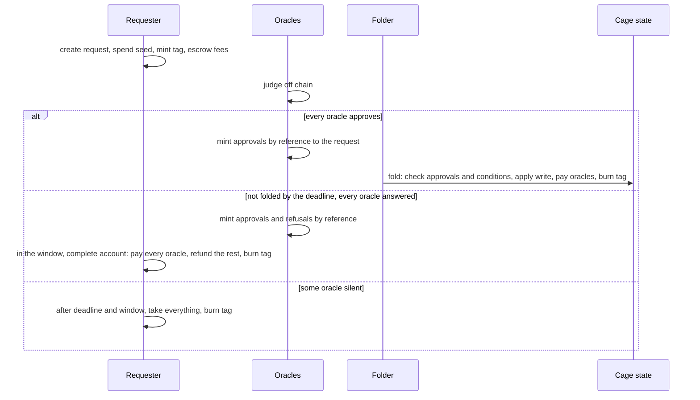

# Requests, oracle judgments and permissionless folds: decisions

As anyone, I want to create a registry by naming the oracles that judge it and
the protocol they judge, so that a registry needs no script, no owner and no
folding infrastructure of its own, and anyone can fold what its oracles have
approved.

This records the design decisions taken on 24 and 25 October 2026, after the
Singular investigation in which the request lifecycle belongs to the
application (lambdasistemi/singular#731, #741). Each decision says what was
decided and why. The Lean statements in `lean/MpfsCage/RequestApprovalFold.lean`
state the earlier single-oracle version of this design and are to be rewritten
against this record.

## Roles

- **Three parties check three things.** The requester states the write and the
  conditions on the tree under which it may apply. Each oracle judges, off
  chain, the aspect of the request it is responsible for (for Moog: GitHub
  keys, repository roles, signatures), independently of the tree. The folder,
  anyone, shows that the write applies to the tree now.
- **The oracles are the application.** In Singular's terms the oracles play the
  application: they decide admission, not tree validity. Different oracles
  check different things, so an application is composed from oracles, which
  may be shared between applications.
- **Folding is permissionless.** Whether a fold is accepted does not depend on
  who submits it. The folder chooses which approved requests to include and
  their order; it cannot apply an unapproved request, change a write, or
  consume a request without applying it.
- **No externalized state.** Unlike Singular, the fold mints and burns no
  per-key token; everything stays in the tree. Generalizing to both designs is
  out of scope.

## Registries

- **Anyone can create a registry.** Creating one mints the cage state with an
  empty root, the set of oracles and the protocol. No script is applied to a
  registry.
- **Everything is declared at creation and never changes.** A permissionless
  registry cannot have changeable parts, because whoever may change them would
  hold power over everyone who trusted the contract.
- **The oracle set and the protocol are the registry's identity.** Every entry
  of the tree means "judged by these oracles under this protocol". Changing the
  oracles would leave part of the tree judged one way and part another, and no
  migration repairs that: a migrated tree carries the mix along. New judges
  mean a new, empty registry.
- **A registry has no owner and no end.** The oracles are the only judges and
  they only judge requests; a centralized power to end or freeze the registry
  above distributed judgment of requests makes no sense. A registry whose
  oracles stop answering simply stops moving. Trust is placed in the oracles
  when they are enumerated; nothing in the protocol can rescue a registry from
  a bad one.
- **Oracles need not consent to being listed.** Listing is an offer of
  business; an oracle that does not serve a registry never answers its
  requests.
- **The protocol is named by hash.** The registry carries the hash of a
  document describing, in CDDL, its keys, values and evidence, and optionally
  which key prefix each oracle judges. Oracles publish off chain which
  protocols they serve. An oracle that does not understand a request does not
  answer it, so the protocol affects progress, never safety.

## Requests

- **One request script per release** serves every registry. It is the spending
  validator of the request address and the minting policy of the tags,
  approvals and refusals.
- **A request names its registry by data.**
- **A request carries one write**: `set key value` or `unset key`. The write is
  on chain in the request datum, paid for by the requester, so readers rebuild
  the tree by replaying folds at no cost. A protocol may store a hash as the
  value, in which case serving the preimage is the key holder's
  responsibility.
- **A request carries conditions**: `key absent` or `key equals value`, on any
  key, checked at the fold against the tree reached when the request is
  applied. Compare-and-swap is a write with a condition on its own key; a
  blind write has no conditions. Fold-time conditions are required because a
  generic system cannot foresee every state-based consideration of its
  applications. The oracles check that the conditions suffice for their rules;
  the fold checks that they hold.
- **A request carries evidence**, an opaque field the chain never reads. The
  registry's protocol decides whether it holds the evidence itself or its
  hash, with the content delivered to the oracles off chain. Both have valid
  uses: on chain lets anyone audit the oracles' reasons; off chain is cheaper.
- **A request carries a seed**, an output reference spent by the transaction
  that creates it, so that no two requests in history are equal and no
  judgment can be replayed onto a copied request.
- **A request carries a deadline and a window.** Folds and judgments happen
  before the deadline. The owner cannot withdraw before the deadline plus the
  window, which protects oracles that have judged from losing their fee.

## Judgments

- **Every oracle of the registry must approve** a request before it can fold.
- **An oracle approves or refuses by minting a token** under the request
  script's policy, with the request output as a reference input. The token can
  sit in any output, typically the oracle's own wallet. Nothing is spent, so
  oracles never contend for the request output.
- **A judgment's name** hashes the registry, the request (including its seed),
  the oracle and the verdict. Judgments do not expire: the request's deadline
  bounds them, and an oracle that finds a deadline too far for its judgment to
  stay valid does not answer.
- **A fold signed by an oracle counts as that oracle's approval** of every
  request in it, so a single oracle that folds itself needs no separate
  approval transaction.
- **Dead judgments are harmless.** Once the request is gone its seed can never
  recur; the holder burns the token whenever it likes.

## Discovery

- **The requester mints a tag** under the request script's policy into the
  request output. Minting requires the seed spent in the same transaction and
  the cage state as a reference input, proving that the registry exists.
- **Every path that consumes a request burns its tag**, so an asset query
  returns only live requests.
- **Folders find work through approval tokens.**
- The address staking-part alternative was declined.

## Money

- **The request pays for judgment, not for outcome.** It declares a fee per
  oracle, held in the request's value. Approving and refusing pay the same
  fee, so an oracle gains nothing by choosing either verdict and judges
  honestly. A refusal is worth paying for: it is the signed record of why, and
  the evidence a settlement needs.
- **Each window has exactly one exit, so exits never race.** Several folders
  may compete for the same cage state and several parties may submit the same
  settlement, but which exit ends a request never depends on who submits first.

  | Window | The only exit |
  |---|---|
  | Before the deadline | The fold, with an approval from every oracle. |
  | From the deadline to the deadline plus the window | The complete account. |
  | After the window | The owner's withdrawal. |

- **The fold pays every oracle its fee.** What remains in the request after
  the fees is the folder's bid; the fold writes no refund outputs, so batches
  are larger.
- **The complete account settles a request after its deadline.** Anyone may
  consume the request by showing, for every oracle of the registry, its
  approval or its refusal, in any mix. Each oracle is paid its fee and the rest
  returns to the owner. The outcome does not depend on which verdicts are
  shown, so the owner cannot hide an approval to save a fee. A refused request
  therefore waits for its deadline; the requester, who sets the deadline,
  bounds that wait.
- **A refusal is no early exit.** Letting the owner leave before the deadline
  on one refusal would let it hide the approvals of the other oracles, or would
  pay oracles that never judged.
- **Equivocation is accepted, not prevented.** The chain cannot stop an oracle
  from minting both an approval and a refusal for the same request; preventing
  it would need a ballot per oracle burned at judgment. Under the windows above
  it changes nothing: before the deadline only approvals are usable, and after
  it every verdict pays the same. Both verdicts stay on chain under the
  oracle's signature, so the equivocation is public and provable; its cost is
  the oracle's reputation.
- **After the window the owner takes everything.** The chain cannot tell a
  silent oracle from a hidden approval, so the owner decides whether to pay the
  oracles that answered. A silent oracle loses its fee; good oracles carry a
  small risk while they decide whether to keep serving a registry with a
  silent member.

## The old design as a special case

The current MPFS cage is a registry with one oracle that also folds: its
`Insert`, `Delete` and `Update` are writes with the matching condition on their
own key, its tip is the oracle fee, and its processing and retract windows are
the deadline and the window. The old cage owner's powers to transfer and end a
cage have no counterpart.

## Not decided

- One tag per request, named after the registry, or one tag per oracle, named
  after the oracle, so that each oracle finds all its pending requests across
  every registry with one asset query.
- Ordering as an auction: conflicting approved requests are ordered by the
  folder, and bids decide which wins.
- Hold-up by complementary oracles: each oracle can block a request, so the
  total price of judgment tends to exceed that of one integrated oracle.
- Encodings of the hashed names (the Singular line uses CBOR specified in
  CDDL), the datum layout and the migration of existing cages.
- Fold cost: the cost per condition proof and per judgment reference input is
  to be measured on a devnet.

